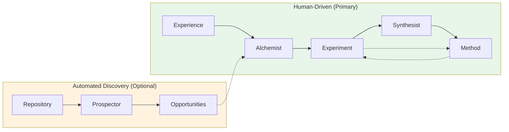
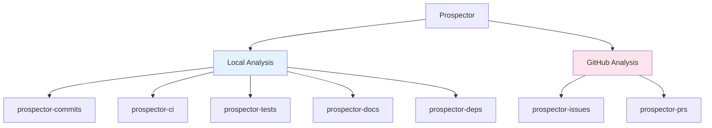

# Using AI Agents

Three OpenCode agents help you contribute to Field Guides:

| Agent | Purpose | When to Use |
|-------|---------|-------------|
| **Alchemist** | Document experiments | You have an experience to capture |
| **Synthesist** | Create methods | You have experiments that reveal a pattern |
| **Prospector** | Find experiment opportunities | You want to mine a repo for undocumented learnings |

**Start with Alchemist** - experiments are fundamentally human experiences worth documenting. Once you understand that workflow, **Synthesist** helps you build methods from evidence. **Prospector** automates discovery when you want to systematically mine repositories for opportunities.

These agents guide you through structured workflows, ensuring your contributions are rigorous, well-formatted, and properly linked.

## Prerequisites

- [OpenCode CLI](https://opencode.ai) installed and configured
- For Alchemist: An engineering experience to document (project, experiment, lesson learned)
- For Synthesist: One or more documented experiments in the Field Guides
- For Prospector: A git repository to analyze (optionally with GitHub access)

---

## Alchemist

The Alchemist transforms raw engineering experiences into documented experiments. It guides you through a 5-phase workflow that ensures your learnings are captured with rigor and aligned with FOE principles.

### When to Use

- You tried something new and learned from it
- A project succeeded or failed in instructive ways
- You want to contribute evidence to support a method
- You have notes, PRs, or documentation from an engineering effort worth preserving

### How to Invoke

```
@alchemist
```

The Alchemist will greet you and begin the intake process.

### The 5-Phase Workflow

| Phase | Name | What Happens |
|-------|------|--------------|
| 1 | **Intake** | Gather source material (files, URLs, notes, timeline, team context) |
| 2 | **FOE Questioning** | Align your learning with FOE principles (Understanding, Feedback, Confidence) |
| 3 | **Critical Review** | Challenge methodology, identify confounding variables, question causation |
| 4 | **Documentation** | Generate the experiment markdown file with proper structure |
| 5 | **Method Mapping** | Link experiment to existing methods or create draft methods |

<details>
<summary><strong>Example Session</strong></summary>

```
You: @alchemist

Alchemist: Welcome to the Alchemist. I help transform your engineering 
experiences into documented evidence that strengthens our Field Guides.

Let's begin. I'll guide you through five phases:
1. Intake - Gathering your documentation and context
2. FOE Alignment - Understanding what this means for flow
3. Critical Review - Ensuring methodological rigor
4. Documentation - Creating the experiment file
5. Method Mapping - Connecting to methods

Ready? Let's start with intake...

[Alchemist-Intake activates]

Intake: I'll help gather the source material for your experiment. 

What would you like to document? Please share:
- Any relevant files, URLs, or documentation
- The timeframe this occurred
- Team and environment context

You: We did a project called Prima where we forked OSS tools to build 
an enterprise AI platform. I have the git history and a retrospective 
doc. Timeline was June 2025 - January 2026.

Intake: Great, I've gathered:
- Project: Prima (OSS fork strategy for enterprise AI)
- Timeline: June 2025 - January 2026
- Sources: Git history, retrospective documentation

[Returns to Alchemist]

Alchemist: Now let's align this with FOE principles. Based on what you've 
shared, I'd like to understand:

**Optimize for Understanding:**
What assumptions did this project challenge or confirm about forking 
large OSS codebases?

You: We assumed forking would be faster than building from scratch, 
but we didn't account for the time needed to understand the codebase...

[Conversation continues through all 5 phases]
```

</details>

<details>
<summary><strong>Architecture & Subagents</strong></summary>

```
Alchemist (Primary Orchestrator)
├── alchemist-intake       → Gathers documentation and context
├── alchemist-critic       → Challenges methodology (mandatory)
├── alchemist-scribe       → Writes experiment markdown file
└── alchemist-cartographer → Maps experiment to methods
```

#### alchemist-intake

Collects source material before documentation begins:
- Asks for files, URLs, notes, and other documentation
- Gathers timeline and context information
- Understands team composition and environment
- Returns structured context to the main Alchemist

#### alchemist-critic

Performs mandatory critical evaluation:
- Challenges methodology and assumptions
- Identifies confounding variables
- Questions causation claims (correlation vs causation)
- Suggests improvements to strengthen the experiment
- This phase cannot be skipped - rigorous critique makes experiments more valuable

#### alchemist-scribe

Writes the final experiment documentation:
- Loads the `foe-experiment-framework` skill for templates
- Generates properly structured markdown with frontmatter
- Shows preview for user approval before creating file
- Places file in `docs/docs/field-guides/experiments/`

#### alchemist-cartographer

Maps the experiment to methods:
- Searches existing methods for relevant connections
- Suggests which methods this experiment supports
- Can create draft methods if experiment reveals new approaches
- Updates experiment frontmatter with method links
- Suggests maturity level implications

</details>

### What Gets Created

After completing the workflow, you'll have:

```
docs/docs/field-guides/experiments/your-experiment-name.md
```

With frontmatter linking to relevant methods:

```yaml
---
title: "Your Experiment Title"
status: completed
methods:
  - agentic-coding/methods/emerging/some-method
---
```

### Tips for Best Results

1. **Come prepared** - Have links to PRs, docs, retrospectives, or notes ready
2. **Don't skip the critique** - The `alchemist-critic` phase strengthens your experiment by identifying limitations you might have missed
3. **Failed experiments are valuable** - Learning what *doesn't* work saves others from the same dead ends
4. **Be specific** - Concrete details (dates, metrics, team size) make experiments more credible and useful

---

## Synthesist

The Synthesist creates methods by finding patterns across documented experiments. It guides you through a 7-step wizard to ensure methods are grounded in evidence, properly structured, and placed correctly within Field Guides.

### When to Use

- You have documented experiments that reveal a reusable practice
- You want to codify lessons learned into guidance others can follow
- You want to add new experiments to strengthen an existing method

### How to Invoke

```
@synthesist
```

The Synthesist will greet you and ask for your experiments.

### Two Modes

| Mode | When to Use |
|------|-------------|
| **Create New Method** | Experiments reveal a practice not yet captured |
| **Update Existing Method** | New experiments provide additional evidence for an existing method |

The Synthesist asks which mode you want after gathering your experiments.

### The 7-Step Wizard

| Step | Name | What Happens |
|------|------|--------------|
| 1 | **Gather** | Provide experiment file paths; warns if only 1 experiment |
| 2 | **Analyze** | Find patterns, common problems, shared approaches |
| 3 | **Name** | Choose method name from AI-suggested options |
| 4 | **Scope** | Define "When to Use" and "When NOT to Use" |
| 5 | **Steps** | Extract actionable how-to guidance |
| 6 | **Place** | Set maturity level and choose field guide |
| 7 | **Generate** | Create method file, update experiment frontmatter |

<details>
<summary><strong>Example Session</strong></summary>

```
You: @synthesist

Synthesist: Welcome to the Synthesist. I help transform your documented 
experiments into methods that others can follow.

I'll guide you through 7 steps:
1. Gather - Collect your experiments
2. Analyze - Find patterns across them
3. Name - Choose a method name and overview
4. Scope - Define when to use (and when not to)
5. Steps - Extract how it works
6. Place - Set maturity and field guide
7. Generate - Create the method file

Ready? Let's start with Step 1...

**Step 1 of 7: Gather Experiments**

Which experiments should inform this method? Please provide file paths 
or experiment names.

You: docs/docs/field-guides/experiments/prima-oss-fork-strategy.md

Synthesist: I've read the experiment:
- **Prima: Enterprise AI Platform via OSS Fork Strategy** (completed)

Note: Methods are stronger with multiple experiments. We can proceed 
with one, but consider this method 'early stage' until more evidence 
accumulates.

Are you creating a **new method** or **updating an existing method**?

You: new method

Synthesist: **Step 2 of 7: Pattern Analysis**

[synthesist-analyzer activates and returns analysis]

Based on analyzing your experiment, here's what I found:

**Common Problem:** Teams fork large OSS codebases without investing 
time to understand them, leading to technical and knowledge debt.

**Core Insight:** Understanding investment before architectural 
decisions pays dividends; the time "saved" by not learning is spent 
on debugging and hotfixes.

Does this capture the essence of what you're trying to codify?

You: Yes, that's right.

Synthesist: **Step 3 of 7: Name & Overview**

Based on the analysis, here are suggested names:

1. **Understanding-First Protocol Adoption** - Emphasizes the approach
2. **Invest Before You Fork** - Emphasizes the action
3. **OSS Comprehension Investment** - Emphasizes the domain

Which resonates? Or suggest your own.

You: I like option 1

[Conversation continues through all 7 steps]
```

</details>

<details>
<summary><strong>Architecture & Subagents</strong></summary>

```
Synthesist (Primary Guided Wizard)
├── synthesist-analyzer → Finds patterns across experiments
└── synthesist-scribe   → Writes method file, updates experiments
```

#### synthesist-analyzer

Analyzes experiments to find synthesizable patterns:
- Loads both `foe-experiment-framework` and `foe-method-framework` skills
- Identifies common problems, shared approaches, consistent outcomes
- Generates 2-3 method name suggestions with rationale
- Assesses appropriate maturity level based on experiment count and outcomes
- Suggests applicability (when to use / when not to use)

**Maturity Assessment Rubric:**

| Experiments | Outcomes | Recommended Maturity |
|-------------|----------|---------------------|
| 1 | Any | `experimenting` |
| 2+ | Mixed | `experimenting` |
| 2+ | Consistently positive | `validated` |
| 3+ | Positive across contexts | `proven` |

#### synthesist-scribe

Writes the method and maintains bidirectional links:
- Loads `foe-method-framework` skill for templates
- Generates method markdown with proper structure and frontmatter
- Places file in correct folder based on maturity:
  - `hypothesized` / `experimenting` → `methods/emerging/`
  - `validated` / `proven` → `methods/established/`
- Shows preview for user approval
- Updates each experiment's `methods:` frontmatter to reference the new method
- Reports completion with file paths

</details>

### What Gets Created

After completing the wizard, you'll have:

**New method file:**
```
docs/docs/field-guides/{guide}/methods/emerging/your-method.md
```

**Updated experiment frontmatter:**
```yaml
methods:
  - guide-name/methods/emerging/your-method
```

### Method Placement

Methods are placed based on maturity level:

| Maturity | Folder | Criteria |
|----------|--------|----------|
| Hypothesized | `emerging/` | Proposed, not yet tested |
| Experimenting | `emerging/` | Active experiments underway |
| Validated | `established/` | Supporting evidence exists |
| Proven | `established/` | Multiple confirming experiments |

### Tips for Best Results

1. **Multiple experiments = stronger methods** - One experiment can work, but the method will start at "experimenting" maturity
2. **Be specific about applicability** - Vague "when to use" guidance isn't useful; be concrete about situations
3. **Don't overclaim maturity** - It's better to start lower and advance than to overclaim and lose credibility
4. **Let the wizard guide you** - The step-by-step process ensures nothing is missed

---

## How They Work Together

The three agents form a complete contribution workflow:



### Typical Workflow

1. **Document with Alchemist** - When you have a raw engineering experience
2. **Synthesize with Synthesist** - When you have enough experiments to extract a method
3. **Update with Synthesist** - When new experiments strengthen existing methods
4. **Discover with Prospector** - When you want to mine a repository for undocumented learnings

### Prospector: Automated Discovery

The Prospector is an **optional automation layer**. It doesn't replace the human-driven workflow - it helps you find opportunities you might have missed.

Most experiments will still start with a human saying "I learned something worth capturing" and invoking Alchemist directly. Use Prospector when you want to systematically surface learning opportunities from repository history.

### Bidirectional Links

Both agents maintain the relationship between methods and experiments:

- **Method frontmatter** lists its supporting experiments
- **Experiment frontmatter** lists the methods it supports
- The `<RelatedExperiments />` and `<RelatedMethods />` components render these links automatically

This creates a web of evidence where readers can trace any method back to the experiments that support it, and any experiment forward to the methods it informs.

---

## Prospector

The Prospector mines repositories for undocumented experiments - moments where something was tried and something was learned, but never formally captured.

Think of it as an automated way to surface the learning opportunities hiding in your git history, CI pipelines, and GitHub discussions.

### When to Use

- You're onboarding to a new codebase and want to understand its history
- You suspect there are undocumented learnings in your team's repository
- You want to systematically find experiment opportunities across a project
- You're doing a retrospective and want data-driven insights

### How to Invoke

```
@prospector
```

The Prospector will ask about scope, GitHub integration, and timeframe before beginning analysis.

### The 5-Phase Workflow

| Phase | Name | What Happens |
|-------|------|--------------|
| 1 | **Initialization** | Gather repo path, GitHub URL (optional), timeframe |
| 2 | **Parallel Analysis** | 7 subagents analyze the repo simultaneously |
| 3 | **Synthesis** | Correlate findings, identify overlaps, score opportunities |
| 4 | **Report** | Present prioritized experiment opportunities with evidence |
| 5 | **Handoff** | Send selected opportunities to Alchemist for documentation |

<details>
<summary><strong>Architecture & Subagents</strong></summary>

The Prospector orchestrates 7 specialized subagents that run in parallel:



**Local Analysis (always runs):**

| Subagent | Analyzes | Signals |
|----------|----------|---------|
| `prospector-commits` | Git commit history | Debugging crunches, refactoring waves, revert patterns |
| `prospector-ci` | CI/CD configuration | Pipeline evolution, test stage additions, failure patterns |
| `prospector-tests` | Test files | Coverage gaps, late test additions, test-to-code ratios |
| `prospector-docs` | Documentation | Doc gaps, outdated docs, knowledge concentration |
| `prospector-deps` | Dependencies | Major version bumps, fork decisions, security updates |

**GitHub Analysis (requires URL):**

| Subagent | Analyzes | Signals |
|----------|----------|---------|
| `prospector-issues` | GitHub issues | Bug clusters, retrospectives, tech debt acknowledgments |
| `prospector-prs` | Pull requests | Architectural debates, reverted PRs, learning moments |

All subagents run **in parallel** for performance, then findings are correlated to identify the strongest opportunities.

</details>

### What Gets Produced

A **Prospector Report** with prioritized opportunities:

```markdown
# Prospector Report: [repo name]

## Analysis Summary
- **Repository:** /path/to/repo
- **GitHub:** github.com/org/repo
- **Timeframe:** Last 6 months
- **Commits analyzed:** 342

## Experiment Opportunities

### 1. Authentication Refactoring - Evidence: High
**FOE Principle:** Understanding
**Sources:** commits, PRs, issues
**Timeframe:** Oct-Nov 2025

The team rewrote the auth system twice in 6 weeks. PR discussions 
reveal initial assumptions about session handling were wrong.

**Hypothesis Hint:** "If we had invested time understanding the 
existing auth flow, then we could have avoided the rewrite..."
```

You select which opportunities to document, and Prospector hands them to Alchemist with pre-populated context.

### Tips for Best Results

1. **Start with a focused timeframe** - "Last 6 months" is usually most actionable
2. **Include GitHub if available** - Issues and PRs often contain the richest learning context
3. **Don't document everything** - Select 1-2 high-evidence opportunities to start
4. **Human judgment matters** - Prospector surfaces patterns; you decide what's meaningful
