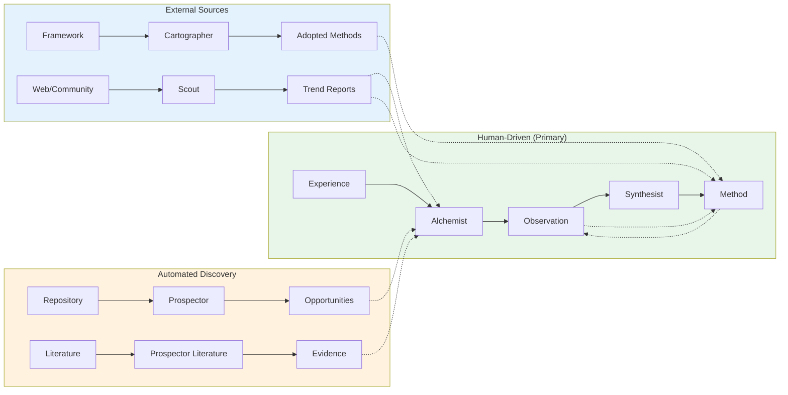
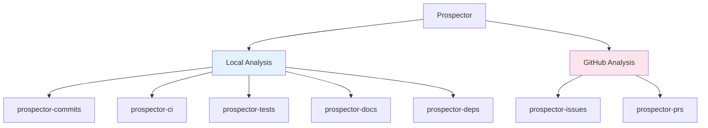

# Field Guide Agents

Five OpenCode agents help you contribute to Field Guides:

| Agent | Purpose | When to Use |
|-------|---------|-------------|
| **Alchemist** | Document observations | You have an experience to capture |
| **Synthesist** | Create methods | You have observations that reveal a pattern |
| **Prospector** | Find observation opportunities | You want to mine a repo or external sources for learnings |
| **Framework Cartographer** | Import external frameworks | You want to adopt methods from DORA, BDD, etc. |
| **Scout** | Survey external trends | You want to discover what's new in agentic coding |

**Start with Alchemist** - observations are fundamentally human experiences worth documenting. Once you understand that workflow, **Synthesist** helps you build methods from evidence. **Prospector** automates discovery when you want to systematically mine repositories or external sources for opportunities. **Framework Cartographer** imports established industry frameworks, making their methods available for adoption. **Scout** surveys the external landscape (Reddit, YouTube, GitHub, skills.sh) to discover trends and opportunities that might inform FOE methods.

These agents guide you through structured workflows, ensuring your contributions are rigorous, well-formatted, and properly linked.

## Prerequisites

- [OpenCode CLI](https://opencode.ai) installed and configured
- For Alchemist: An engineering experience to document (project, observation, lesson learned)
- For Synthesist: One or more documented observations in the Field Guides
- For Prospector: A git repository to analyze (optionally with GitHub access)

---

## Alchemist

The Alchemist transforms raw engineering experiences into documented observations. It guides you through a 5-phase workflow that ensures your learnings are captured with rigor and aligned with FOE principles.

### When to Use

- You tried something new and learned from it
- A project succeeded or failed in instructive ways
- You want to contribute evidence to support a method
- You have notes, PRs, or documentation from an engineering effort worth preserving

### How to Invoke

```
@alchemist
```

The Alchemist will greet you and begin the intake process.

### The 5-Phase Workflow

| Phase | Name | What Happens |
|-------|------|--------------|
| 1 | **Intake** | Gather source material (files, URLs, notes, timeline, team context) |
| 2 | **FOE Questioning** | Align your learning with FOE principles (Understanding, Feedback, Confidence) |
| 3 | **Critical Review** | Challenge methodology, identify confounding variables, question causation |
| 4 | **Documentation** | Generate the observation markdown file with proper structure |
| 5 | **Method Mapping** | Link observation to existing methods or create draft methods |

<details>
<summary><strong>Example Session</strong></summary>

```
You: @alchemist

Alchemist: Welcome to the Alchemist. I help transform your engineering 
experiences into documented evidence that strengthens our Field Guides.

Let's begin. I'll guide you through five phases:
1. Intake - Gathering your documentation and context
2. FOE Alignment - Understanding what this means for flow
3. Critical Review - Ensuring methodological rigor
4. Documentation - Creating the observation file
5. Method Mapping - Connecting to methods

Ready? Let's start with intake...

[Alchemist-Intake activates]

Intake: I'll help gather the source material for your observation. 

What would you like to document? Please share:
- Any relevant files, URLs, or documentation
- The timeframe this occurred
- Team and environment context

You: We did a project called Prima where we forked OSS tools to build 
an enterprise AI platform. I have the git history and a retrospective 
doc. Timeline was June 2025 - January 2026.

Intake: Great, I've gathered:
- Project: Prima (OSS fork strategy for enterprise AI)
- Timeline: June 2025 - January 2026
- Sources: Git history, retrospective documentation

[Returns to Alchemist]

Alchemist: Now let's align this with FOE principles. Based on what you've 
shared, I'd like to understand:

**Optimize for Understanding:**
What assumptions did this project challenge or confirm about forking 
large OSS codebases?

You: We assumed forking would be faster than building from scratch, 
but we didn't account for the time needed to understand the codebase...

[Conversation continues through all 5 phases]
```

</details>

<details>
<summary><strong>Architecture & Subagents</strong></summary>

```
Alchemist (Primary Orchestrator)
├── alchemist-intake       → Gathers documentation and context
├── alchemist-critic       → Challenges methodology (mandatory)
├── alchemist-scribe       → Writes observation markdown file
└── alchemist-cartographer → Maps observation to methods
```

#### alchemist-intake

Collects source material before documentation begins:
- Asks for files, URLs, notes, and other documentation
- Gathers timeline and context information
- Understands team composition and environment
- Returns structured context to the main Alchemist

#### alchemist-critic

Performs mandatory critical evaluation:
- Challenges methodology and assumptions
- Identifies confounding variables
- Questions causation claims (correlation vs causation)
- Suggests improvements to strengthen the observation
- This phase cannot be skipped - rigorous critique makes observations more valuable

#### alchemist-scribe

Writes the final observation documentation:
- Loads the `foe-observation-framework` skill for templates
- Generates properly structured markdown with frontmatter
- Shows preview for user approval before creating file
- Places file in `docs/docs/field-guides/observations/`

#### alchemist-cartographer

Maps the observation to methods:
- Searches existing methods for relevant connections
- Suggests which methods this observation supports
- Can create draft methods if observation reveals new approaches
- Updates observation frontmatter with method links
- Suggests maturity level implications

</details>

### What Gets Created

After completing the workflow, you'll have:

```
docs/docs/field-guides/observations/your-observation-name.md
```

With frontmatter linking to relevant methods:

```yaml
---
title: "Your Observation Title"
status: completed
methods:
  - agentic-coding/methods/emerging/some-method
---
```

### Tips for Best Results

1. **Come prepared** - Have links to PRs, docs, retrospectives, or notes ready
2. **Don't skip the critique** - The `alchemist-critic` phase strengthens your observation by identifying limitations you might have missed
3. **Failed observations are valuable** - Learning what *doesn't* work saves others from the same dead ends
4. **Be specific** - Concrete details (dates, metrics, team size) make observations more credible and useful

---

## Synthesist

The Synthesist creates methods by finding patterns across documented observations. It guides you through a 7-step wizard to ensure methods are grounded in evidence, properly structured, and placed correctly within Field Guides.

### When to Use

- You have documented observations that reveal a reusable practice
- You want to codify lessons learned into guidance others can follow
- You want to add new observations to strengthen an existing method

### How to Invoke

```
@synthesist
```

The Synthesist will greet you and ask for your observations.

### Two Modes

| Mode | When to Use |
|------|-------------|
| **Create New Method** | Observations reveal a practice not yet captured |
| **Update Existing Method** | New observations provide additional evidence for an existing method |

The Synthesist asks which mode you want after gathering your observations.

### The 7-Step Wizard

| Step | Name | What Happens |
|------|------|--------------|
| 1 | **Gather** | Provide observation file paths; warns if only 1 observation |
| 2 | **Analyze** | Find patterns, common problems, shared approaches |
| 3 | **Name** | Choose method name from AI-suggested options |
| 4 | **Scope** | Define "When to Use" and "When NOT to Use" |
| 5 | **Steps** | Extract actionable how-to guidance |
| 6 | **Place** | Set maturity level and choose field guide |
| 7 | **Generate** | Create method file, update observation frontmatter |

<details>
<summary><strong>Example Session</strong></summary>

```
You: @synthesist

Synthesist: Welcome to the Synthesist. I help transform your documented 
observations into methods that others can follow.

I'll guide you through 7 steps:
1. Gather - Collect your observations
2. Analyze - Find patterns across them
3. Name - Choose a method name and overview
4. Scope - Define when to use (and when not to)
5. Steps - Extract how it works
6. Place - Set maturity and field guide
7. Generate - Create the method file

Ready? Let's start with Step 1...

**Step 1 of 7: Gather Observations**

Which observations should inform this method? Please provide file paths 
or observation names.

You: docs/docs/field-guides/observations/prima-oss-fork-strategy.md

Synthesist: I've read the observation:
- **Prima: Enterprise AI Platform via OSS Fork Strategy** (completed)

Note: Methods are stronger with multiple observations. We can proceed 
with one, but consider this method 'early stage' until more evidence 
accumulates.

Are you creating a **new method** or **updating an existing method**?

You: new method

Synthesist: **Step 2 of 7: Pattern Analysis**

[synthesist-analyzer activates and returns analysis]

Based on analyzing your observation, here's what I found:

**Common Problem:** Teams fork large OSS codebases without investing 
time to understand them, leading to technical and knowledge debt.

**Core Insight:** Understanding investment before architectural 
decisions pays dividends; the time "saved" by not learning is spent 
on debugging and hotfixes.

Does this capture the essence of what you're trying to codify?

You: Yes, that's right.

Synthesist: **Step 3 of 7: Name & Overview**

Based on the analysis, here are suggested names:

1. **Conceptual Debt Prevention** - Emphasizes the approach
2. **Invest Before You Fork** - Emphasizes the action
3. **OSS Comprehension Investment** - Emphasizes the domain

Which resonates? Or suggest your own.

You: I like option 1

[Conversation continues through all 7 steps]
```

</details>

<details>
<summary><strong>Architecture & Subagents</strong></summary>

```
Synthesist (Primary Guided Wizard)
├── synthesist-analyzer → Finds patterns across observations
└── synthesist-scribe   → Writes method file, updates observations
```

#### synthesist-analyzer

Analyzes observations to find synthesizable patterns:
- Loads both `foe-observation-framework` and `foe-method-framework` skills
- Identifies common problems, shared approaches, consistent outcomes
- Generates 2-3 method name suggestions with rationale
- Assesses appropriate maturity level based on observation count and outcomes
- Suggests applicability (when to use / when not to use)

**Maturity Assessment Rubric:**

| Observations | Outcomes | Recommended Maturity |
|-------------|----------|---------------------|
| 1 | Any | `observing` |
| 2+ | Mixed | `observing` |
| 2+ | Consistently positive | `validated` |
| 3+ | Positive across contexts | `proven` |

#### synthesist-scribe

Writes the method and maintains bidirectional links:
- Loads `foe-method-framework` skill for templates
- Generates method markdown with proper structure and frontmatter
- Places file in correct folder based on maturity:
  - `hypothesized` / `observing` → `methods/emerging/`
  - `validated` / `proven` → `methods/established/`
- Shows preview for user approval
- Updates each observation's `methods:` frontmatter to reference the new method
- Reports completion with file paths

</details>

### What Gets Created

After completing the wizard, you'll have:

**New method file:**
```
docs/docs/field-guides/{guide}/methods/emerging/your-method.md
```

**Updated observation frontmatter:**
```yaml
methods:
  - guide-name/methods/emerging/your-method
```

### Method Placement

Methods are placed based on maturity level:

| Maturity | Folder | Criteria |
|----------|--------|----------|
| Hypothesized | `emerging/` | Proposed, not yet tested |
| Observing | `emerging/` | Active observations underway |
| Validated | `established/` | Supporting evidence exists |
| Proven | `established/` | Multiple confirming observations |

### Tips for Best Results

1. **Multiple observations = stronger methods** - One observation can work, but the method will start at "observing" maturity
2. **Be specific about applicability** - Vague "when to use" guidance isn't useful; be concrete about situations
3. **Don't overclaim maturity** - It's better to start lower and advance than to overclaim and lose credibility
4. **Let the wizard guide you** - The step-by-step process ensures nothing is missed

---

## Framework Cartographer

The Framework Cartographer imports established industry frameworks (like DORA, BDD, SPACE) into the External Frameworks documentation, making their methods available for adoption by Field Guides.

### When to Use

- You want to adopt methods from a recognized industry framework
- You're referencing established practices that should be properly documented
- You want to import a framework that partially exists (add new methods)

### How to Invoke

```
@framework-cartographer
```

The Cartographer will ask what framework you want to import.

### The 7-Phase Workflow

| Phase | Name | What Happens |
|-------|------|--------------|
| 1 | **Input Gathering** | Provide framework name, URL, or specific method |
| 2 | **Research** | Subagent searches for authoritative sources, extracts metadata |
| 3 | **Validation** | Verify legitimacy, determine status level, assess FOE alignment |
| 4 | **Check Existing** | See if framework already exists in the system |
| 5 | **Scope Selection** | Choose which methods to import (all or select) |
| 6 | **Documentation** | Create framework overview and method files |
| 7 | **Adoption Suggestions** | Recommend Field Guide adoptions based on FOE alignment |

<details>
<summary><strong>Example Session</strong></summary>

```
You: @framework-cartographer

Cartographer: Welcome to the Framework Cartographer. I help map external 
industry frameworks into our documentation system.

What would you like to import? You can provide:
- A URL to a framework (e.g., https://dora.dev)
- A framework name (e.g., 'DORA', 'SPACE', 'Team Topologies')
- A specific method (e.g., 'DORA Deployment Frequency')

You: BDD

Cartographer: Let me research BDD (Behavior-Driven Development)...

[cartographer-researcher activates, searches web for authoritative sources]

Research complete. Now validating...

[cartographer-validator activates, verifies legitimacy]

**Validation Results for BDD:**
- Status: well-established
- Creator: Dan North (2006)
- FOE Alignment: High (Understanding, Feedback, Confidence)
- Methods identified: 7

Does this look accurate?
- [x] Looks correct

Cartographer: This framework has 7 methods. What would you like to import?
- [ ] All methods (Recommended)
- [ ] Select methods
- [ ] Single method

You: All methods

[cartographer-scribe creates documentation files]

**Framework imported successfully!**

Created:
- docs/docs/external-frameworks/bdd/overview.md
- docs/docs/external-frameworks/bdd/methods/discovery-workshops.md
- docs/docs/external-frameworks/bdd/methods/three-amigos.md
- ... (7 method files)

**Suggested Adoptions:**
| Method | Suggested Field Guide | FOE Principle |
|--------|----------------------|---------------|
| Given-When-Then | Agentic Coding | Understanding |
| Executable Specifications | Agentic Coding | Fast Feedback |

Would you like me to add any of these adoptions?
```

</details>

<details>
<summary><strong>Architecture & Subagents</strong></summary>

```
Framework Cartographer (Primary Orchestrator)
├── cartographer-researcher → Searches web for authoritative sources
├── cartographer-validator  → Verifies legitimacy, determines status level
└── cartographer-scribe     → Writes framework and method documentation
```

#### cartographer-researcher

Gathers information about the framework:
- Searches for authoritative primary sources
- Extracts metadata (authors, organization, year)
- Identifies methods/practices within the framework
- Finds supporting citations

#### cartographer-validator

Validates research findings:
- Verifies the framework is legitimate and recognized
- Determines status level: `emerging`, `well-established`, or `industry-standard`
- Assesses FOE alignment (Understanding, Feedback, Confidence)
- Flags any concerns or missing information

#### cartographer-scribe

Creates the documentation:
- Generates `_category_.json` files for Docusaurus navigation
- Creates framework `overview.md` with proper frontmatter
- Creates individual method `.md` files
- Shows preview for approval before writing files

</details>

### What Gets Created

After completing the workflow, you'll have:

**Framework structure:**
```
docs/docs/external-frameworks/[framework]/
├── _category_.json
├── overview.md
└── methods/
    ├── _category_.json
    ├── method-1.md
    ├── method-2.md
    └── ...
```

**Method frontmatter includes:**
```yaml
---
title: "Method Name"
framework: [framework-slug]
pillar: [framework pillar if applicable]
foe_alignment:
  understanding: high | medium | low
  fast_feedback: high | medium | low
  confidence: high | medium | low
---
```

### Framework Status Levels

| Status | Criteria | Examples |
|--------|----------|----------|
| `emerging` | New, limited adoption, evolving | - |
| `well-established` | Mature, widely adopted, stable | BDD, Team Topologies |
| `industry-standard` | Universal recognition, de facto standard | DORA |

### Tips for Best Results

1. **Start with the name** - Most established frameworks are recognized by name
2. **Review validation** - Check that the research captured the framework accurately
3. **Import all methods** - Easier to adopt selectively than re-import later
4. **Add adoptions** - Methods are more useful when adopted into Field Guides

---

## Scout

The Scout surveys the external landscape of agentic coding - Reddit discussions, YouTube tutorials, GitHub repos, skills.sh, and broader web sources - to discover trends and opportunities that might inform FOE methods.

Think of it as your intelligence agent for staying current with the rapidly evolving agentic coding ecosystem.

### When to Use

- You want to know what's trending in agentic coding this week
- You're looking for practices or tools that could become FOE methods
- You want to find external research or case studies to document as external observation
- You're curious what the community is discussing about AI coding assistants

### How to Invoke

```
@scout
```

Scout will ask about your focus area, timeframe, and which sources to crawl.

### The 6-Phase Workflow

| Phase | Name | What Happens |
|-------|------|--------------|
| 1 | **Intake** | Determine focus area, timeframe, sources to include |
| 2 | **Context Loading** | Read previous reports for delta comparison |
| 3 | **Parallel Crawl** | Dispatch all 5 subagents simultaneously |
| 4 | **Synthesis** | Merge findings, identify trends, deduplicate |
| 5 | **Opportunity Mapping** | Tag items as method or observation candidates |
| 6 | **Report Generation** | Write structured markdown with frontmatter |

<details>
<summary><strong>Example Session</strong></summary>

```
You: @scout

Scout: I'm ready to survey the agentic coding landscape. Let me understand 
what you're looking for:

1. **Focus:** General scan of all trends, or specific topic?
2. **Timeframe:** Past week (default), past month, or custom?
3. **Sources:** All 5 crawlers, or specific ones?

What would you like to explore?

You: General scan, past week, all sources

Scout: Starting a comprehensive scan of the agentic coding landscape...

[Dispatches 5 subagents in parallel]

- @scout-reddit scanning r/LocalLLaMA, r/ClaudeAI, r/ChatGPT...
- @scout-youtube searching for tutorials and demos...
- @scout-github checking trending repos and releases...
- @scout-skillssh analyzing skills.sh catalog...
- @scout-web scanning HN, Twitter, arXiv, blogs...

[After all return]

**Synthesis complete.** I found 23 findings across all sources.

Key trends this week:
1. MCP adoption accelerating - mentioned across Reddit, GitHub, YouTube
2. New multi-agent framework from Microsoft getting attention
3. skills.sh has 3 skills relevant for FOE adaptation

[Generates full report at research/agentic-trends/01-25-26-trends.md]
```

</details>

<details>
<summary><strong>Architecture & Subagents</strong></summary>

```
Scout (Primary Orchestrator)
├── scout-reddit    → r/LocalLLaMA, r/ClaudeAI, r/ChatGPT, r/MachineLearning
├── scout-youtube   → Tutorials, demos, conference talks
├── scout-github    → Trending repos, releases, discussions
├── scout-skillssh  → skills.sh catalog with FOE adaptation analysis
└── scout-web       → HN, Twitter/X, arXiv, company blogs
```

All subagents run **in parallel** for performance, then findings are merged and deduplicated.

#### scout-reddit

Crawls Reddit communities focused on AI and coding:
- Searches target subreddits using Google site search
- Extracts post titles, summaries, upvote counts
- Identifies discussions about tools, techniques, and trends
- Returns structured YAML with relevance scoring

#### scout-youtube

Searches YouTube for agentic coding content:
- Finds tutorials, demos, and conference talks
- Extracts video titles, channels, view counts
- Summarizes content focus and key topics
- Prioritizes recent uploads and high-engagement content

#### scout-github

Monitors GitHub for trending repositories and releases:
- Uses `gh` CLI for API access to repos and releases
- Tracks key repos (LangChain, AutoGen, CrewAI, etc.)
- Extracts star counts, recent activity, release notes
- Identifies new frameworks and significant updates

#### scout-skillssh

Analyzes skills.sh for reusable AI coding skills:
- Catalogs available skills with descriptions
- Assesses each skill's fit for FOE adaptation
- Notes what modifications would be needed
- Suggests which field guide each skill supports

#### scout-web

Crawls broader web sources:
- Hacker News discussions
- Twitter/X announcements and threads
- arXiv papers on agents
- Company blogs (Anthropic, OpenAI, etc.)
- Tags each source with quality tier

</details>

### What Gets Created

After completing the workflow, you'll have a trend report:

```
research/agentic-trends/01-25-26-trends.md
```

With frontmatter for downstream processing:

```yaml
---
type: scout-report
title: "Agentic Coding Trends"
date: "01-25-26"
period_start: "01-18-26"
period_end: "01-25-26"
status: new

sources_crawled:
  - reddit
  - youtube
  - github
  - skills_sh
  - hacker_news
  - twitter
  - arxiv
  - company_blogs

metrics:
  total_findings: 23
  new_since_last: 15
  method_candidates: 3
  observation_candidates: 5
  skills_analyzed: 8

delta_comparison:
  previous_report: "01-18-26-trends.md"
  new_trends: ["mcp-adoption", "multi-agent-frameworks"]
  evolved_trends: ["cursor-ecosystem"]
---
```

### Report Sections

1. **Executive Summary** - 3-5 bullet points of key takeaways
2. **Key Trends** - Top findings with analysis
3. **FOE Opportunities** - Method and observation candidates
4. **Skills Analysis** - Relevant skills.sh findings with adaptation notes
5. **Source Breakdown** - Detailed findings by source
6. **What's New** - Delta from last report

### Delta Tracking

Scout compares each finding against previous reports:
- **NEW** - Not mentioned before
- **EVOLVED** - Mentioned before but showing growth/change
- **RECURRING** - Stable trend, still relevant

This prevents report fatigue by highlighting what's genuinely new.

### Tips for Best Results

1. **Start with a general scan** - Get the lay of the land before focusing
2. **Weekly cadence works well** - Agentic coding moves fast but not daily
3. **Follow up on opportunities** - Use Alchemist to document observation candidates
4. **Check skills.sh adaptations** - Skills can become FOE methods with modification

---

## How They Work Together

The five agents form a complete contribution workflow:



### Typical Workflow

1. **Document with Alchemist** - When you have a raw engineering experience
2. **Synthesize with Synthesist** - When you have enough observations to extract a method
3. **Update with Synthesist** - When new observations strengthen existing methods
4. **Discover with Prospector** - When you want to mine a repository for undocumented learnings
5. **Find evidence with Prospector Literature** - When you want external validation for methods
6. **Import with Cartographer** - When you want to adopt methods from established frameworks
7. **Survey with Scout** - When you want to discover external trends that might inform FOE

### Prospector: Automated Discovery

The Prospector is an **optional automation layer**. It doesn't replace the human-driven workflow - it helps you find opportunities you might have missed.

Most observations will still start with a human saying "I learned something worth capturing" and invoking Alchemist directly. Use Prospector when you want to systematically surface learning opportunities from repository history or external sources.

### Bidirectional Links

Both agents maintain the relationship between methods and observations:

- **Method frontmatter** lists its supporting observations
- **Observation frontmatter** lists the methods it supports
- **Supporting Evidence** and **Methods This Supports** sections are automatically rendered at the end of each page based on frontmatter

This creates a web of evidence where readers can trace any method back to the observations that support it, and any observation forward to the methods it informs.

---

## Prospector

The Prospector mines repositories for undocumented observations - moments where something was tried and something was learned, but never formally captured.

Think of it as an automated way to surface the learning opportunities hiding in your git history, CI pipelines, and GitHub discussions.

### When to Use

- You're onboarding to a new codebase and want to understand its history
- You suspect there are undocumented learnings in your team's repository
- You want to systematically find observation opportunities across a project
- You're doing a retrospective and want data-driven insights

### How to Invoke

```
@prospector
```

The Prospector will ask about scope, GitHub integration, and timeframe before beginning analysis.

### The 5-Phase Workflow

| Phase | Name | What Happens |
|-------|------|--------------|
| 1 | **Initialization** | Gather repo path, GitHub URL (optional), timeframe |
| 2 | **Parallel Analysis** | 7 subagents analyze the repo simultaneously |
| 3 | **Synthesis** | Correlate findings, identify overlaps, score opportunities |
| 4 | **Report** | Present prioritized observation opportunities with evidence |
| 5 | **Handoff** | Send selected opportunities to Alchemist for documentation |

<details>
<summary><strong>Architecture & Subagents</strong></summary>

The Prospector orchestrates 7 specialized subagents that run in parallel:



**Local Analysis (always runs):**

| Subagent | Analyzes | Signals |
|----------|----------|---------|
| `prospector-commits` | Git commit history | Debugging crunches, refactoring waves, revert patterns |
| `prospector-ci` | CI/CD configuration | Pipeline evolution, test stage additions, failure patterns |
| `prospector-tests` | Test files | Coverage gaps, late test additions, test-to-code ratios |
| `prospector-docs` | Documentation | Doc gaps, outdated docs, knowledge concentration |
| `prospector-deps` | Dependencies | Major version bumps, fork decisions, security updates |

**GitHub Analysis (requires URL):**

| Subagent | Analyzes | Signals |
|----------|----------|---------|
| `prospector-issues` | GitHub issues | Bug clusters, retrospectives, tech debt acknowledgments |
| `prospector-prs` | Pull requests | Architectural debates, reverted PRs, learning moments |

All subagents run **in parallel** for performance, then findings are correlated to identify the strongest opportunities.

</details>

### What Gets Produced

A **Prospector Report** with prioritized opportunities:

```markdown
# Prospector Report: [repo name]

## Analysis Summary
- **Repository:** /path/to/repo
- **GitHub:** github.com/org/repo
- **Timeframe:** Last 6 months
- **Commits analyzed:** 342

## Observation Opportunities

### 1. Authentication Refactoring - Evidence: High
**FOE Principle:** Understanding
**Sources:** commits, PRs, issues
**Timeframe:** Oct-Nov 2025

The team rewrote the auth system twice in 6 weeks. PR discussions 
reveal initial assumptions about session handling were wrong.

**Hypothesis Hint:** "If we had invested time understanding the 
existing auth flow, then we could have avoided the rewrite..."
```

You select which opportunities to document, and Prospector hands them to Alchemist with pre-populated context.

### Literature Prospector

In addition to mining repositories, Prospector can search **external sources** for evidence that supports or challenges FOE methods.

#### How to Invoke

```
@prospector-external
```

The Literature Prospector will ask which methods to investigate and what type of evidence to find.

#### What It Searches

| Source | Description | Quality Tier |
|--------|-------------|--------------|
| **FOE Bookshelf** | 35+ curated books and resources with pre-mapped FOE relevance | High signal |
| **Academic sources** | Research papers, studies, meta-analyses | Tier 1 |
| **Industry research** | DORA reports, Thoughtworks Radar | Tier 2 |
| **Case studies** | Engineering blogs from major tech companies | Tier 3 |
| **Practitioner content** | Blogs, talks, community insights | Tier 4 |

#### When to Use

- You want external validation for an existing method
- You're curious if research supports or contradicts a method's claims
- You want to strengthen a method's maturity level with external observation
- You're writing a method and want to cite supporting sources

<details>
<summary><strong>Architecture & Subagents</strong></summary>

```
Prospector Literature (Orchestrator)
├── prospector-bookshelf → Searches FOE curated reading list
└── prospector-web       → Searches web with quality tier tagging
```

#### prospector-bookshelf

Searches the FOE Bookshelf (35+ books/resources):
- Matches method keywords against book metadata
- Uses the `keywords[]` array and `foeRelevance` text
- Returns ranked matches with connection reasoning
- High signal-to-noise ratio (pre-curated sources)

#### prospector-web

Searches the web for evidence:
- Generates targeted queries for academic and practitioner sources
- Tags every result with a quality tier (academic, industry-research, case-study, practitioner)
- Fetches and assesses top results for relevance
- Flags contradicting evidence for method review

</details>

#### What Gets Produced

A **Literature Evidence Report** with quality-tiered findings:

```markdown
# Literature Prospector Report

## Method: Conceptual Debt Prevention
**Current Maturity:** observing
**Investigation Mode:** both

## Bookshelf Evidence

### High Relevance
1. **The Programmer's Brain** by Felienne Hermans
   - **Evidence Type:** supporting
   - **Connection:** Directly supports distinction between API familiarity 
     and model understanding through cognitive science research...

## Web Evidence

### Academic Sources (Tier 1)
1. **The Role of Mental Models in API Usability** - Myers, B. et al.
   - **Quality:** academic (CHI conference)
   - **Key Finding:** Developers with accurate mental models made 40% fewer errors...
```

After reviewing the report, you can hand off selected sources to Alchemist for formal external observation documentation.

### Tips for Best Results

1. **Start with a focused timeframe** - "Last 6 months" is usually most actionable
2. **Include GitHub if available** - Issues and PRs often contain the richest learning context
3. **Don't document everything** - Select 1-2 high-evidence opportunities to start
4. **Human judgment matters** - Prospector surfaces patterns; you decide what's meaningful
