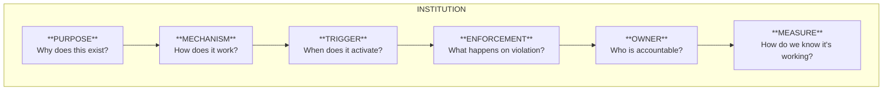

# Building Institutions

In FOE, "institutions" are lightweight but real mechanisms that make desired behavior the default. They're not bureaucracy; they're the scaffolding that makes good practices automatic rather than heroic.

## What Institutions Are (And Aren't)

### Institutions Are

- **Mechanisms**: Concrete systems that change behavior
- **Lightweight**: Minimum viable process, not maximum
- **Consistent**: Applied the same way every time
- **Enforced**: Violations are caught and addressed
- **Repeatable**: Work regardless of who's involved
- **Measurable**: You can tell if they're working

### Institutions Are Not

- **Bureaucracy**: Heavy processes that slow work down
- **Documentation**: Policies that exist only on paper
- **Ceremony**: Meetings and rituals without substance
- **Heroics**: Depending on specific people to maintain standards
- **Aspirations**: What you wish would happen

:::tip
The test of an institution: Does the desired behavior happen automatically, even when no one is watching?
:::

## The Anatomy of a Good Institution

Every effective institution has these components:



### Example: Automated Testing Gate

| Component | Definition |
|-----------|-----------|
| **Purpose** | Prevent untested code from reaching production |
| **Mechanism** | CI pipeline runs tests; failures block merge |
| **Trigger** | Every pull request |
| **Enforcement** | Merge is technically impossible without passing tests |
| **Owner** | Platform team maintains pipeline; teams own their tests |
| **Measure** | Test pass rate, escaped defects, deployment frequency |

## Core FOE Institutions

These are the fundamental institutions that support FOE transformation:

### 1. Continuous Integration Gate

**Purpose**: Ensure all code changes are validated before integration.

**Implementation**:
- Automated tests run on every commit
- Static analysis and linting
- Security scanning
- Build verification

**Enforcement**: Technical block: code cannot be merged without passing CI.

**Common Failure Modes**:
- Allowing bypasses "just this once"
- Flaky tests that are ignored
- CI that's too slow (>10 minutes)
- Coverage gates set too low to matter

### 2. Code Review Standard

**Purpose**: Ensure quality through peer verification and knowledge sharing.

**Implementation**:
- Required reviewer(s) for all changes
- Review checklist or guidelines
- Time expectations (e.g., review within 4 hours)
- Clear approval criteria

**Enforcement**: Technical block: approval required before merge.

**Common Failure Modes**:
- Rubber-stamp approvals
- Reviewers who don't understand the code
- Reviews that focus on style over substance
- Bottleneck reviewers who slow everything down

### 3. Definition of Done

**Purpose**: Establish clear, shared standards for "complete" work.

**Implementation**:
- Written checklist applicable to all work
- Covers code, tests, documentation, deployment
- Reviewed and updated periodically
- Visible and referenced in workflow

**Enforcement**: Social contract backed by review and retrospective.

**Common Failure Modes**:
- Definition exists but is ignored under pressure
- Definition is too vague to be actionable
- Definition is too rigid to fit all work types
- Definition never gets updated

### 4. Deployment Automation

**Purpose**: Make deployment safe, fast, and repeatable.

**Implementation**:
- Single command/click deployment
- Automated rollback capability
- Environment parity (staging mirrors production)
- Deployment logging and tracking

**Enforcement**: No manual deployments allowed; all changes go through pipeline.

**Common Failure Modes**:
- "Emergency" manual deployments that become normal
- Automation that doesn't work for all change types
- Insufficient monitoring to catch deployment issues
- Rollback that's theoretical but never tested

### 5. Learning Practice

**Purpose**: Continuous improvement through shared learning.

**Implementation**:
- Regular cadence (weekly, bi-weekly)
- Protected time (calendar blocks)
- Rotating facilitators
- Action items tracked and followed up

**Enforcement**: Management participation and accountability.

**Common Failure Modes**:
- Sessions that get cancelled under pressure
- Same people always presenting
- Insights that don't lead to action
- Format becomes stale

## Designing New Institutions

When you identify a gap that needs an institution:

### Step 1: Define the Problem Clearly

- What behavior are you trying to change?
- What's the cost of the current state?
- Who is affected?

### Step 2: Design the Minimum Viable Institution

Ask:
- What's the simplest mechanism that could work?
- What triggers it?
- How is it enforced?
- Who owns it?

:::warning
Start simpler than you think necessary. You can add complexity later; removing it is much harder.
:::

### Step 3: Implement with Technical Enforcement Where Possible

Prefer technical enforcement over social enforcement:

| Enforcement Type | Example | Reliability |
|-----------------|---------|-------------|
| Technical (hard) | Merge blocked without tests | High |
| Technical (soft) | Warning in PR but can override | Medium |
| Social (explicit) | Checklist in PR template | Low-Medium |
| Social (implicit) | "We always do this" | Low |

### Step 4: Assign Clear Ownership

Every institution needs **one accountable owner**:
- Responsible for the institution working
- Empowered to make changes
- Measured on effectiveness
- Not the only person who can operate it (bus factor > 1)

:::tip
Clear ownership doesn't mean one person does all the work. It means one person is accountable for the outcome.
:::

### Step 5: Define Success Metrics

How will you know the institution is working?

| Institution | Leading Indicators | Lagging Indicators |
|-------------|-------------------|-------------------|
| CI Gate | Build pass rate, time to green | Escaped defects |
| Code Review | Review turnaround time | Knowledge distribution |
| Definition of Done | Checklist completion rate | Rework rate |
| Deployment Automation | Deployment frequency | Change failure rate |
| Learning Practice | Attendance, action completion | Improvement velocity |

### Step 6: Iterate

Institutions aren't static:
- Review effectiveness quarterly
- Adjust based on metrics
- Retire institutions that no longer serve their purpose
- Evolve as the team matures

## Sustaining Institutions

Creating institutions is easier than maintaining them. Here's how to make them stick:

### Make Them Invisible

The best institutions fade into the background:
- Part of the normal workflow, not an extra step
- Automated where possible
- Minimal friction for compliance

### Protect Them from Pressure

Institutions face their greatest test during crunch time:
- Executive sponsorship to maintain standards under pressure
- Clear escalation for proposed exceptions
- Post-pressure retrospective on any bypasses

### Model from the Top

Leadership behavior sets the norm:
- Leaders follow the same institutions
- Violations by leaders are addressed publicly
- Institutional compliance is celebrated, not mocked

### Measure and Report

Visibility drives accountability:
- Dashboard showing institutional health
- Regular reporting to stakeholders
- Trends over time, not just point-in-time

## Light Governance Principles

FOE governance is "light but real":

### Light

- Minimum viable process
- Automate over administrate
- Trust but verify
- Default to yes, with guardrails

### Real

- Consistent enforcement
- No exceptions without escalation
- Measured outcomes
- Accountable ownership

:::tip
The goal of governance is to make the right thing easy and the wrong thing hard, not to make everything hard.
:::

## GovCon: Policy Development and Sustainable Practices

:::tip[GovCon Insight]
Government contracts often require formal policies and procedures. FOE institutions can satisfy these requirements while remaining lightweight and effective. The key is mapping FOE practices to compliance language.
:::

### Mapping Institutions to Compliance Requirements

| Compliance Requirement | FOE Institution | Evidence |
|-----------------------|-----------------|----------|
| Configuration Management Plan | Version control workflow + CI/CD | Git logs, pipeline configs |
| Quality Assurance Plan | Testing gate + code review | Test reports, PR history |
| Change Control Process | PR workflow + automated gates | PR templates, merge rules |
| Training Plan | Learning practice | Session records, action items |

### Writing Policies That Enable Rather Than Constrain

When writing policies for government contracts:

1. **Start with the outcome**: What behavior do you want?
2. **Define the minimum requirement**: What must happen?
3. **Allow flexibility in implementation**: How can vary
4. **Include measurement**: How will you know it's working?

**Example Policy Structure**:
```markdown
## Purpose
[What problem this solves]

## Requirement
[What must happen: outcome-focused]

## Implementation
[How this is typically achieved: flexible]

## Verification
[How compliance is measured]

## Exceptions
[Process for handling edge cases]
```

### Sustainable Practices for Contract Transitions

Institutions must survive contract transitions:

- **Document the why, not just the what**: Future teams need context
- **Automate institutional knowledge**: Codify in pipelines and tools
- **Train on institutions, not just tools**: Transfer the thinking, not just the mechanics
- **Measure institutional health**: Quantified institutions transfer better than qualitative ones

## Institution Checklist

Use this checklist when creating or evaluating an institution:

- [ ] Purpose is clear and documented
- [ ] Mechanism is defined and implemented
- [ ] Trigger is specific and consistent
- [ ] Enforcement is technical where possible
- [ ] One accountable owner is assigned
- [ ] Success metrics are defined
- [ ] Institution is as light as possible while being real
- [ ] Failure modes are identified and mitigated
- [ ] Review cadence is established
- [ ] Stakeholders understand and support the institution

## Conclusion

Institutions are how FOE practices become sustainable. Without them, good practices depend on vigilance and heroics, and both run out eventually. With them, good practices become the default, and the team's energy goes toward improvement rather than maintenance.

The investment in building institutions pays compound returns. Each institution that works reduces the effort required to maintain quality, freeing capacity for the next improvement. This is how teams build momentum toward higher phases of maturity.

---

## Katalyst: Institutions as Code

:::info[With Katalyst]
Katalyst Taxonomy provides **institutional enforcement through layer types**. Instead of relying on documentation, checklists, or human vigilance, Katalyst encodes your institutions directly into the scaffolding that creates new components.
:::

### Layer Types as Institutional Mechanisms

Each Katalyst layer type is an institution:

| Layer Type | Institution It Enforces | What It Includes |
|------------|------------------------|------------------|
| `app-docker` | Consistent containerization | Dockerfile, docker-compose, CI config |
| `k8s-kustomize` | Kubernetes deployment standards | Base manifests, environment overlays |
| `k8s-argocd` | GitOps deployment | ArgoCD application definitions |
| `iac-terragrunt` | Infrastructure standards | Terragrunt modules, state management |

### Technical Enforcement via Scaffolding

When a developer runs:

```bash
kata create layer api-gateway \
  --layer-type app-docker \
  --parent backend-services \
  --owner platform-team@example.com \
  --environment dev
```

The institution is automatically enforced:

```
api-gateway/
├── layer.yaml              # Taxonomy definition (ownership, dependencies)
├── Dockerfile              # Multi-stage build following standards
├── docker-compose.yaml     # Local development configuration
├── .github/
│   └── workflows/
│       └── ci.yaml         # CI/CD pipeline (pre-configured)
├── base/
│   └── kustomization.yaml  # Shared Kubernetes config
└── dev/
    └── kustomization.yaml  # Environment-specific overlay
```

Every new service automatically includes:
- Correct directory structure
- Pre-configured CI/CD
- Observability integration
- Schema-validated configuration

### Schema Validation as Continuous Enforcement

The `kata lint` command validates that all nodes conform to institutional requirements:

```bash
kata lint
```

Output:
```
Validating 47 taxonomy nodes...
ERROR: api-gateway/layer.yaml
  - Missing required field: spec.owners
  - Invalid environment: 'production' (expected: dev, staging, prod)

WARN: auth-service/layer.yaml
  - No dependsOn declared (consider if this is intentional)

Valid: 45/47 nodes
```

Run this in CI to catch violations before they merge.

### Institution Anatomy → Katalyst Mapping

| Institution Component | Katalyst Implementation |
|----------------------|------------------------|
| **Purpose** | Layer type description |
| **Mechanism** | Scaffolding templates |
| **Trigger** | `kata create` command |
| **Enforcement** | Schema validation + `kata lint` |
| **Owner** | Platform team maintains layer types |
| **Measure** | Lint pass rate, scaffolding adoption |

### Creating Custom Institutions

Organizations can define custom layer types that encode their specific standards:

```yaml
# .global/taxonomy/layer-types/secure-api.yaml
apiVersion: katalyst.taxonomy/v1alpha
kind: LayerType
metadata:
  name: secure-api
spec:
  description: API service with security hardening
  inherits: app-docker
  templates:
    - path: security/
      source: templates/security-config/
    - path: .github/workflows/security-scan.yaml
      source: templates/security-scan.yaml
  requiredAnnotations:
    - security-classification
    - data-handling-policy
```

Now every `secure-api` layer includes security scanning and requires security metadata.

**Learn more:** 
- [Katalyst Taxonomy Layer Types](https://esimplicityinc.github.io/katalyst-taxonomy/users/layer-types/)
- [Creating Custom Layer Types](https://esimplicityinc.github.io/katalyst-taxonomy/extending/plugins/layer-types/)
