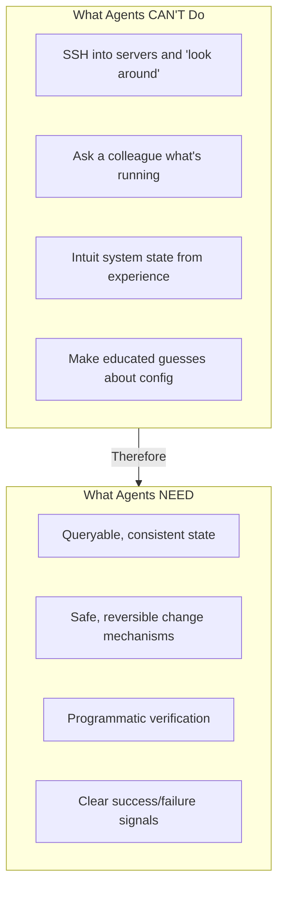
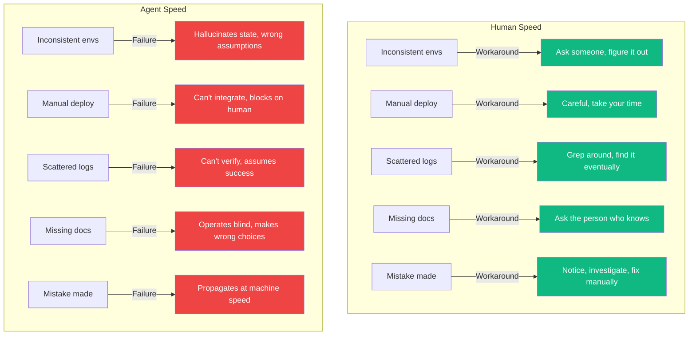
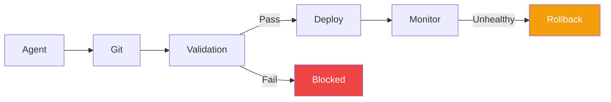
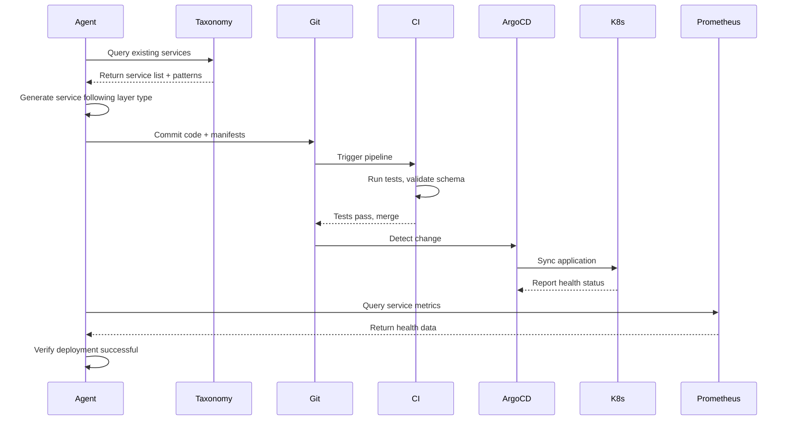
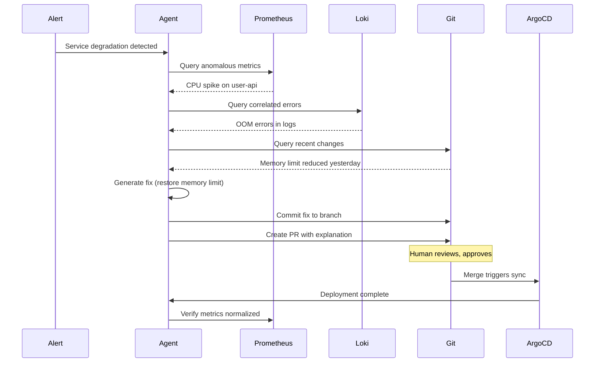

# Katalyst: Critical Infrastructure for Agentic Coding

AI coding agents are transforming software development. But here's what most organizations miss: **the infrastructure that was "nice to have" for human developers is now non-negotiable for AI agents.**

Without declarative, API-driven, self-healing infrastructure, agents don't accelerate your productivity: they amplify your chaos at machine speed.

## The Shift: From Best Practice to Survival Requirement

For years, we've advocated for cloud-native infrastructure as a "best practice." Teams that adopted Kubernetes, GitOps, and observability shipped faster and more reliably. Teams that didn't... survived anyway, through heroics and workarounds.

**That changes with AI agents.**

| Capability | For Humans | For Agents |
|------------|-----------|------------|
| Consistent environments | Nice to have | **Required**: agents can't "figure it out" |
| Declarative state | Best practice | **Required**: agents need queryable truth |
| GitOps deployment | Modern approach | **Required**: agents need safe change paths |
| Observability | Helpful for debugging | **Required**: agents need feedback signals |
| Auto-rollback | Safety net | **Required**: agent mistakes happen fast |

**The bottom line:** Human developers can compensate for infrastructure gaps with intuition, experience, and asking colleagues. Agents cannot.

---

## Why Agents Need Declarative Infrastructure

### The Agent's Dilemma

AI agents can generate code at unprecedented speed. But they face fundamental limitations:



An agent asked to "deploy a new service" needs to:
1. **Understand** what services already exist
2. **Know** where and how to deploy
3. **Execute** the deployment safely
4. **Verify** the deployment succeeded
5. **Recover** if something went wrong

Without proper infrastructure, each of these steps fails.

---

## The Agent Cognitive Loop

Just like humans, agents need the FOE cognitive triangle: **Understand → Act → Confirm → Learn**. Katalyst provides the infrastructure for each phase:

```mermaid
flowchart LR
    subgraph UNDERSTAND["1. UNDERSTAND"]
        direction TB
        K8S_Q["Query Kubernetes API"]
        TAX_Q["Query Taxonomy"]
        PROM_Q["Query Prometheus"]
    end
    
    subgraph ACT["2. ACT"]
        direction TB
        GIT["Commit to Git"]
        ARGO_SYNC["ArgoCD Syncs"]
        K8S_APPLY["K8s Reconciles"]
    end
    
    subgraph CONFIRM["3. CONFIRM"]
        direction TB
        HEALTH["Check Health Status"]
        METRICS["Verify Metrics"]
        TESTS["Run BDD Tests"]
    end
    
    subgraph LEARN["4. LEARN"]
        direction TB
        FEEDBACK["Process Feedback"]
        ADJUST["Adjust Approach"]
    end
    
    UNDERSTAND --> ACT
    ACT --> CONFIRM
    CONFIRM --> LEARN
    LEARN --> UNDERSTAND
    
    style UNDERSTAND fill:#8B5CF6,color:#fff
    style ACT fill:#F59E0B,color:#fff
    style CONFIRM fill:#10B981,color:#fff
    style LEARN fill:#3B82F6,color:#fff
```



---

## How Katalyst Enables Safe Agentic Operations

### 1. UNDERSTAND: Querying System State

**The Problem Without Katalyst:**

| Agent Question | Without Infrastructure | Result |
|----------------|----------------------|--------|
| "What services exist?" | No reliable answer | Agent guesses, creates duplicates |
| "What's the current config?" | Drift between environments | Agent uses wrong assumptions |
| "What's the architecture?" | Stale docs, tribal knowledge | Agent violates patterns |
| "What's healthy/unhealthy?" | Manual checking required | Agent operates blind |

**How Katalyst Solves It:**

| Katalyst Component | What It Provides | Agent Capability |
|-------------------|------------------|------------------|
| **Kubernetes API** | Declarative, queryable state | `kubectl get` returns ground truth |
| **Katalyst Taxonomy** | Architecture-as-code | `kata tree` returns system structure |
| **Prometheus** | Metrics API | Query current system health |
| **ArgoCD** | Sync status | Query deployment state |

```bash
# Agent can programmatically discover system state
kubectl get deployments -o json
kata show my-system/backend/api-services --format json
curl -s prometheus:9090/api/v1/query?query=up
argocd app list -o json
```

**Key insight:** Every question an agent might ask has a programmatic, reliable answer.

---

### 2. ACT: Making Changes Safely

**The Problem Without Katalyst:**

| Agent Action | Without Infrastructure | Risk |
|--------------|----------------------|------|
| Deploy new service | Direct `kubectl apply` | No audit trail, no review |
| Modify config | Edit files directly | Drift from source of truth |
| Scale resources | Manual commands | No record of why or when |
| Fix incident | Ad-hoc changes | Can't reproduce or rollback |

**How Katalyst Solves It:**



```mermaid
flowchart LR
    AGENT["AI Agent"] -->|"Commits change"| GIT["Git Repository"]
    GIT -->|"PR created"| CI["CI Pipeline"]
    CI -->|"Tests pass"| MERGE["Merge"]
    MERGE -->|"Detected"| ARGO["ArgoCD"]
    ARGO -->|"Reconciles"| K8S["Kubernetes"]
    K8S -->|"If unhealthy"| ROLLBACK["Auto-Rollback"]
    
    style GIT fill:#10B981,color:#fff
    style ARGO fill:#3B82F6,color:#fff
    style ROLLBACK fill:#EF4444,color:#fff
```

**The GitOps Chokepoint:**
- Every agent change goes through Git
- CI gates validate before deployment
- Changes are auditable and attributable
- Rollback is one `git revert` away

**Why This Matters for Agents:**
- Agents make mistakes at machine speed
- Without guardrails, mistakes propagate instantly
- GitOps creates a "checkpoint" before every change
- Auto-rollback catches what CI misses

---

### 3. CONFIRM: Verifying Results

**The Problem Without Katalyst:**

| Agent Question | Without Infrastructure | Result |
|----------------|----------------------|--------|
| "Did my deployment work?" | Unclear | Agent assumes success |
| "Is the service healthy?" | Manual checking | Agent moves on prematurely |
| "Did I break anything?" | Wait for user reports | Damage accumulates |
| "Do the tests pass?" | No automated tests | Agent can't verify correctness |

**How Katalyst Solves It:**

| Verification Need | Katalyst Solution | Agent Integration |
|------------------|-------------------|-------------------|
| Deployment success | ArgoCD sync status | `argocd app get <app> -o json` |
| Service health | Prometheus + Grafana | Query health metrics via API |
| Log analysis | Loki | Query structured logs |
| Distributed tracing | Tempo | Trace request flows |
| Functional correctness | BDD Tests | Run Cucumber scenarios |

```gherkin
# Agent can run BDD tests to verify behavior
@api @smoke
Scenario: Service responds after deployment
  Given the service "user-api" is deployed
  When I GET "/health"
  Then the response status should be 200
  And the response time should be less than 500ms
```

**The Feedback Loop:**
- Agent makes change → ArgoCD syncs → Prometheus collects metrics → Agent queries results
- Immediate, programmatic feedback
- No human in the loop for routine verification

---

## The Critical Enablers: Why "Nice to Have" Becomes "Must Have"

### At Human Speed vs. Agent Speed



### The Enablers Table

| Capability | Human Workaround | Why Agents Can't Workaround | Katalyst Solution |
|------------|------------------|----------------------------|-------------------|
| **System discovery** | Ask colleagues, explore manually | No colleagues, can't SSH, can't intuit | Kubernetes API + Taxonomy |
| **Safe changes** | Careful PRs, manual review | Speed amplifies mistakes, volume exceeds review | GitOps + auto-rollback |
| **State verification** | Manual checking, intuition | Can't "look and see," no intuition | Observability stack |
| **Pattern compliance** | Code review catches drift | Volume exceeds human review capacity | Schema validation + policy gates |
| **Error recovery** | Human notices, intervenes | Mistakes propagate before humans notice | ArgoCD self-heal + alerts |
| **Audit trail** | Memory, tickets, chat history | Agents don't remember context | Git history + ArgoCD events |

---

## The Platform as Agent Guardrails

Katalyst doesn't just enable agents, it constrains them safely.

### Guardrail 1: GitOps as Chokepoint



- **All changes through Git**: No direct cluster manipulation
- **CI validates before merge**: Schema, tests, security scans
- **ArgoCD validates after merge**: Health checks, sync status
- **Automatic rollback**: Failed deployments revert

**Why it matters:** An agent can't accidentally `kubectl delete namespace production` because it never has direct cluster access.

### Guardrail 2: Declarative State as Ground Truth

- Agent can't create "snowflake" configurations
- Desired state is in Git; actual state reconciles to match
- Drift is automatically corrected
- No "it works on my cluster" problems

### Guardrail 3: Observability as Feedback

- Agents get immediate signal on change impact
- Prometheus alerts catch regressions
- Metrics provide objective success criteria
- Agents can verify their own work

### Guardrail 4: Policy as Code

- OPA/Gatekeeper enforces constraints automatically
- Agent output validated before merge
- Security and compliance checks at machine speed
- No "the agent bypassed the review process"

---

## Real-World Agent Workflows

### Example 1: Agent Deploys a New Service



### Example 2: Agent Investigates and Fixes an Incident



---

## Without This Infrastructure, Agents Fail

| Scenario | Without Katalyst | With Katalyst |
|----------|------------------|---------------|
| Agent deploys bad config | Manual discovery hours later, manual fix | Auto-rollback in seconds |
| Agent can't find service | Guesses, creates duplicate | Queries Taxonomy, finds existing |
| Agent needs to verify change | Hopes for the best, moves on | Checks Prometheus, confirms health |
| Agent creates non-standard code | Merged, becomes tech debt | Blocked by schema validation |
| Agent causes incident | Humans scramble at 3am | Self-healing + alert to agent |
| Agent asked "what changed?" | No reliable answer | Git history + ArgoCD events |

---

## The Connection to Phase 3

This is why [Phase 3 (Cloud-Native Infrastructure)](/docs/transformation-model/phase-3-cloud-native-infrastructure) is prerequisite for [Phase 4 (Agentic Coding)](/docs/transformation-model/phase-4-agentic-coding).

| Phase 3 Discipline | Why Agents Require It |
|-------------------|----------------------|
| **Declarative infrastructure** | Agents need queryable, consistent state |
| **GitOps** | Agents need safe, auditable change paths |
| **Reconciliation-based ops** | Agent mistakes need automatic correction |
| **Observability** | Agents need programmatic feedback |
| **Policy as code** | Governance must happen at agent speed |

**Without Phase 3 disciplines, Phase 4 is chaos acceleration.**

Organizations that skip Phase 3 and adopt AI agents experience:
- Technical debt accumulating faster than ever
- Incidents caused by changes no one understands
- Drift between intended and actual state
- Review bottlenecks that negate agent productivity
- Security vulnerabilities from unvalidated changes

---

## The Bottom Line

:::tip[The Paradigm Shift]
**For human developers:** Katalyst accelerates flow and reduces friction.

**For AI agents:** Katalyst makes safe operation possible at all.

Cloud-native infrastructure isn't a nice-to-have optimization anymore. It's the foundation that determines whether AI agents multiply your productivity, or multiply your problems.
:::

The organizations that thrive with AI agents won't be those with the best prompts or the most powerful models. They'll be the ones with infrastructure that gives agents:

1. **Reliable ways to understand** what exists
2. **Safe ways to make changes** that can be reviewed and rolled back
3. **Clear feedback** on whether changes worked

Katalyst provides all three. That's why it's not just a platform: it's the prerequisite for the agentic era.

---

## Next Steps

- [Phase 4: Agentic Coding](../transformation-model/phase-4-agentic-coding): The transformation context
- [Why Phase 3 is the Bottleneck](../transformation-model/why-phase-3-is-the-bottleneck): Why you need this foundation first
- [Katalyst Platform Overview](./overview): The full implementation
- [Getting Started with Katalyst](./getting-started): Start building the foundation
