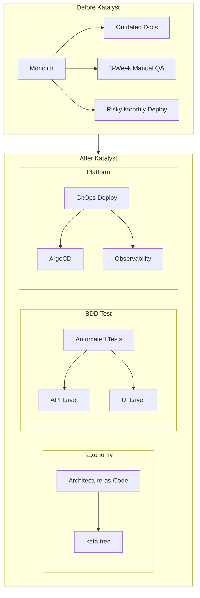
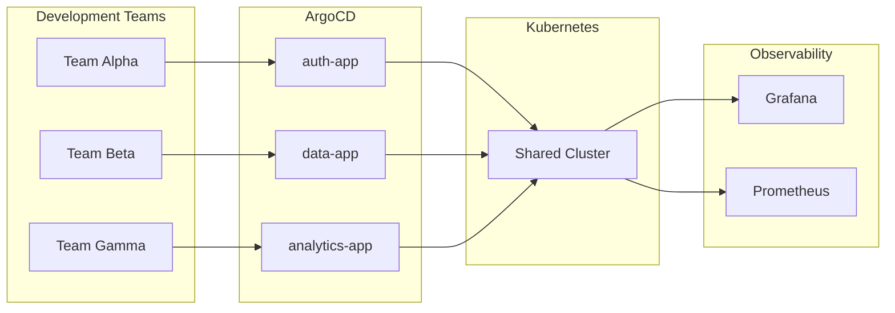
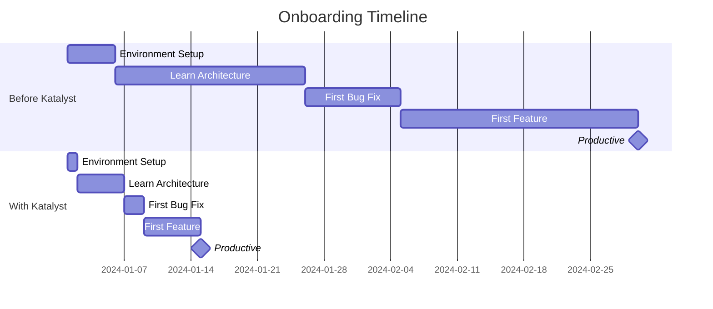

# Katalyst Case Studies

These case studies illustrate how the Katalyst ecosystem implements FOE principles in real-world scenarios.

## Case Study 1: Modernizing a Legacy Government System

### The Challenge

A federal agency needed to modernize a 15-year-old monolithic application:
- **200+ database tables** with undocumented relationships
- **No automated tests** — manual QA took 3 weeks per release
- **Monthly deployments** with frequent rollbacks
- **Tribal knowledge** concentrated in two senior developers

### The FOE Problem

This is a classic **Phase 0 → Phase 3** transformation challenge:
- No understanding of the system (violates "Optimize for Understanding")
- Slow feedback loops (violates "Optimize for Fast Feedback")
- High-risk deployments (violates "Optimize for Confidence")

### The Katalyst Solution



#### Phase 1: Understanding with Taxonomy

The team used Katalyst Taxonomy to document the system:

```yaml
system:
  name: legacy-portal
  description: Federal benefits management system

subsystems:
  - name: eligibility
    description: Determines citizen eligibility
    owner: eligibility-team@agency.gov
    
  - name: enrollment
    description: Handles enrollment workflows
    owner: enrollment-team@agency.gov
    
  - name: reporting
    description: Generates compliance reports
    owner: reporting-team@agency.gov
```

**Result**: First complete architecture documentation in 10 years. New team members could understand the system in days instead of months.

#### Phase 2: Fast Feedback with BDD Test

The team implemented BDD tests for critical paths:

```gherkin
@api @eligibility
Feature: Eligibility Determination

  Scenario: Eligible applicant receives approval
    Given an applicant with income below threshold
    And the applicant has required documentation
    When eligibility is determined
    Then the result should be "ELIGIBLE"
    And the approval date should be today

  Scenario: Ineligible applicant receives denial with reason
    Given an applicant with income above threshold
    When eligibility is determined
    Then the result should be "INELIGIBLE"
    And the denial reason should be "INCOME_EXCEEDS_LIMIT"
```

**Result**: Test coverage went from 0% to 65% in 3 months. QA cycle reduced from 3 weeks to 3 days.

#### Phase 3: Confidence with Platform

The team deployed to Katalyst Platform:

```yaml
# ArgoCD Application
apiVersion: argoproj.io/v1alpha1
kind: Application
metadata:
  name: eligibility-service
spec:
  source:
    repoURL: https://github.com/agency/legacy-portal
    path: services/eligibility
  syncPolicy:
    automated:
      selfHeal: true
      prune: true
```

**Result**: Deployment frequency increased from monthly to weekly. Change failure rate dropped from 30% to 5%.

### Outcomes

| Metric | Before | After | Improvement |
|--------|--------|-------|-------------|
| Time to understand system | 6 months | 2 weeks | 12x faster |
| QA cycle | 3 weeks | 3 days | 7x faster |
| Deployment frequency | Monthly | Weekly | 4x more frequent |
| Change failure rate | 30% | 5% | 6x fewer failures |
| Onboarding time | 3 months | 2 weeks | 6x faster |

---

## Case Study 2: Multi-Team Platform Development

### The Challenge

An organization with 5 development teams building a shared platform:
- **Inconsistent practices** across teams
- **Integration failures** when services combined
- **No shared vocabulary** for architecture discussions
- **Different testing approaches** making quality unpredictable

### The FOE Problem

This is a **coordination and coherence** challenge:
- Teams can't understand each other's components
- Feedback comes too late (at integration time)
- Confidence varies by team

### The Katalyst Solution

#### Shared Taxonomy

All teams adopted the same Katalyst Taxonomy structure:

```
platform-x
├── team-alpha
│   └── auth-stack
│       ├── identity-service (app-docker)
│       ├── token-service (app-docker)
│       └── auth-ui (app-react)
├── team-beta
│   └── data-stack
│       ├── ingestion-service (app-docker)
│       ├── processing-service (app-docker)
│       └── data-api (app-docker)
├── team-gamma
│   └── analytics-stack
│       ├── metrics-collector (app-docker)
│       ├── dashboard-api (app-docker)
│       └── analytics-ui (app-react)
└── shared
    └── infrastructure
        ├── api-gateway (app-helm)
        └── service-mesh (app-helm)
```

**Result**: Any engineer could navigate any team's code. Architecture discussions used consistent vocabulary.

#### Standardized Testing

All teams used Katalyst BDD Test with shared step definitions:

```typescript
// Shared authentication steps used by all teams
Given('I am authenticated as {string}', async function (role: string) {
  const token = await this.authAdapter.authenticate(role);
  this.context.authToken = token;
});

// Team-specific steps extend the shared base
Given('the data pipeline is processing', async function () {
  await this.dataAdapter.waitForPipeline('processing');
});
```

**Result**: Test patterns became portable. Engineers could contribute to any team's tests.

#### Unified Platform

All services deployed through Katalyst Platform:



**Result**: Consistent deployment, monitoring, and alerting across all teams.

### Outcomes

| Metric | Before | After | Improvement |
|--------|--------|-------|-------------|
| Integration failures | Weekly | Monthly | 4x fewer |
| Cross-team PRs | Rare | Common | 10x increase |
| Shared component reuse | 10% | 60% | 6x more reuse |
| Time to deploy new service | 2 weeks | 2 days | 7x faster |

---

## Case Study 3: Accelerated Onboarding

### The Challenge

A growing team needed to onboard 10 new engineers in one quarter:
- **Existing documentation** was scattered and outdated
- **Senior engineers** spent 50% of time answering questions
- **New hires** took 3 months to become productive
- **Inconsistent setups** caused "works on my machine" issues

### The FOE Problem

This is an **institutional knowledge** challenge:
- Knowledge lived in people's heads, not systems
- No fast feedback for new engineers learning the codebase
- Low confidence when making changes to unfamiliar code

### The Katalyst Solution

#### Self-Documenting Architecture

Katalyst Taxonomy provided always-current documentation:

```bash
# New engineer's first day commands
kata tree                    # See the whole system
kata show user-service       # Understand a specific component
kata tui                     # Interactive exploration
```

**Result**: New engineers could explore the architecture independently.

#### Onboarding Test Suite

A dedicated BDD test suite for onboarding:

```gherkin
@onboarding
Feature: Developer Environment Setup

  Scenario: Local development environment works
    Given I have cloned the repository
    When I run "make setup"
    Then all dependencies should be installed
    And the local database should be running
    And the API should respond to health checks

  Scenario: Can run the full test suite
    Given my environment is set up
    When I run "make test"
    Then all tests should pass
    And the test report should be generated

  Scenario: Can deploy to development environment
    Given all tests pass
    When I run "make deploy-dev"
    Then my changes should be deployed
    And I should see my changes in the dev environment
```

**Result**: New engineers verified their setup worked correctly before asking for help.

#### Consistent Environments

Katalyst Platform provided identical environments:

```yaml
# devcontainer.json for consistent local development
{
  "name": "Platform Dev",
  "image": "katalyst/dev-environment:latest",
  "features": {
    "kubectl": "latest",
    "argocd-cli": "latest",
    "kata-cli": "latest"
  },
  "postCreateCommand": "kata init --yes && make setup"
}
```

**Result**: "Works on my machine" issues eliminated.

### Onboarding Timeline Comparison



### Outcomes

| Metric | Before | After | Improvement |
|--------|--------|-------|-------------|
| Time to first commit | 5 days | 1 day | 5x faster |
| Time to productivity | 3 months | 2 weeks | 6x faster |
| Senior engineer time on questions | 50% | 15% | 3x reduction |
| Setup-related issues | 20/month | 2/month | 10x fewer |

---

## Patterns Across Case Studies

### What Works

1. **Start with Taxonomy**: Understanding comes first. You can't test or deploy what you don't understand.

2. **Automate the obvious**: BDD tests for critical paths provide fast feedback and documentation.

3. **Standardize infrastructure**: Katalyst Platform removes deployment as a variable, letting teams focus on features.

4. **Invest in onboarding**: The onboarding experience reveals gaps in your institutions.

### What to Avoid

1. **Don't boil the ocean**: Start with one subsystem, prove value, then expand.

2. **Don't skip the taxonomy**: Teams that jumped straight to Platform without Taxonomy struggled with coordination.

3. **Don't write tests for everything immediately**: Start with critical paths and expand based on risk.

---

## Your Case Study

Ready to create your own success story? Start with the [Getting Started Guide](./getting-started).
