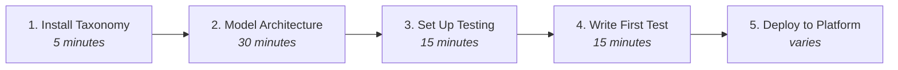

# Getting Started with Katalyst

This guide walks you through adopting the Katalyst ecosystem step by step. Each component can be adopted independently, but they work best together.

## Prerequisites

Before starting, ensure you have:

- **Node.js 18+** for Katalyst BDD Test
- **Python 3.10+** for Katalyst Taxonomy CLI
- **kubectl** and cluster access for Katalyst Platform
- **Git** for version control

## Quick Start Path



---

## Step 1: Install Katalyst Taxonomy

Katalyst Taxonomy helps you understand and document your architecture.

### Install the CLI

```bash
pip install katalyst-taxonomy
```

### Verify Installation

```bash
kata --version
```

### Initialize Your Repository

```bash
cd your-project
kata init --yes
```

This creates a `katalyst.yaml` file and basic directory structure.

---

## Step 2: Model Your Architecture

### Define Your System

Edit `katalyst.yaml` to describe your system:

```yaml
system:
  name: my-application
  description: My application platform
  owner: team@example.com
```

### Create Subsystems

Subsystems are major functional areas:

```bash
kata create subsystem frontend --owner ui-team@example.com
kata create subsystem backend --owner api-team@example.com
kata create subsystem infrastructure --owner platform-team@example.com
```

### Create Stacks

Stacks group related layers:

```bash
kata create stack web-app --parent frontend
kata create stack api-services --parent backend
kata create stack observability --parent infrastructure
```

### Create Layers

Layers are deployable units:

```bash
kata create layer react-ui --parent web-app --layer-type app-docker
kata create layer user-api --parent api-services --layer-type app-docker
kata create layer grafana --parent observability --layer-type app-helm
```

### Visualize Your Architecture

```bash
# Tree view
kata tree

# Interactive TUI
kata tui
```

Example output:

```
my-application
├── frontend
│   └── web-app
│       └── react-ui (app-docker)
├── backend
│   └── api-services
│       └── user-api (app-docker)
└── infrastructure
    └── observability
        └── grafana (app-helm)
```

---

## Step 3: Set Up Katalyst BDD Test

### Install the Framework

```bash
npm install @esimplicityinc/stack-tests
npm install @playwright/test @cucumber/cucumber
npx playwright install
```

### Create Project Structure

```bash
mkdir -p tests/features tests/steps tests/adapters
```

### Configure Playwright

Create `playwright.config.ts`:

```typescript
import { defineConfig } from '@playwright/test';

export default defineConfig({
  testDir: './tests',
  timeout: 30000,
  retries: 1,
  use: {
    baseURL: process.env.BASE_URL || 'http://localhost:3000',
    trace: 'on-first-retry',
  },
});
```

### Configure Cucumber

Create `cucumber.js`:

```javascript
module.exports = {
  default: {
    paths: ['tests/features/**/*.feature'],
    require: ['tests/steps/**/*.ts'],
    requireModule: ['ts-node/register'],
    format: ['progress', 'html:reports/cucumber-report.html'],
  },
};
```

---

## Step 4: Write Your First Test

### Create a Feature File

Create `tests/features/user-api.feature`:

```gherkin
@api
Feature: User API

  Scenario: Health check returns OK
    Given the API is running
    When I GET "/health"
    Then the response status should be 200
    And the response body should contain "ok"

  Scenario: Create a new user
    Given I am authenticated as an admin via API
    When I POST "/users" with JSON body:
      """
      {
        "email": "test@example.com",
        "name": "Test User"
      }
      """
    Then the response status should be 201
    And the response body should contain "id"
```

### Create Step Definitions

Create `tests/steps/api.steps.ts`:

```typescript
import { Given, When, Then } from '@cucumber/cucumber';
import { expect } from '@playwright/test';
import { ApiAdapter } from '../adapters/api.adapter';

let api: ApiAdapter;
let response: any;

Given('the API is running', async function () {
  api = new ApiAdapter(process.env.API_URL || 'http://localhost:3000');
});

Given('I am authenticated as an admin via API', async function () {
  api = new ApiAdapter(process.env.API_URL || 'http://localhost:3000');
  await api.authenticate('admin', process.env.ADMIN_PASSWORD);
});

When('I GET {string}', async function (path: string) {
  response = await api.get(path);
});

When('I POST {string} with JSON body:', async function (path: string, body: string) {
  response = await api.post(path, JSON.parse(body));
});

Then('the response status should be {int}', async function (status: number) {
  expect(response.status).toBe(status);
});

Then('the response body should contain {string}', async function (text: string) {
  const body = await response.text();
  expect(body).toContain(text);
});
```

### Create the API Adapter

Create `tests/adapters/api.adapter.ts`:

```typescript
export class ApiAdapter {
  private baseUrl: string;
  private authToken?: string;

  constructor(baseUrl: string) {
    this.baseUrl = baseUrl;
  }

  async authenticate(username: string, password?: string): Promise<void> {
    // Implement your authentication logic
    const response = await fetch(`${this.baseUrl}/auth/login`, {
      method: 'POST',
      headers: { 'Content-Type': 'application/json' },
      body: JSON.stringify({ username, password }),
    });
    const data = await response.json();
    this.authToken = data.token;
  }

  async get(path: string): Promise<Response> {
    return fetch(`${this.baseUrl}${path}`, {
      headers: this.getHeaders(),
    });
  }

  async post(path: string, body: any): Promise<Response> {
    return fetch(`${this.baseUrl}${path}`, {
      method: 'POST',
      headers: this.getHeaders(),
      body: JSON.stringify(body),
    });
  }

  private getHeaders(): Record<string, string> {
    const headers: Record<string, string> = {
      'Content-Type': 'application/json',
    };
    if (this.authToken) {
      headers['Authorization'] = `Bearer ${this.authToken}`;
    }
    return headers;
  }
}
```

### Run Your Tests

```bash
# Run all tests
npm test

# Run only API tests
npm test -- --tags @api

# Run with specific base URL
BASE_URL=http://staging.example.com npm test
```

---

## Step 5: Deploy to Katalyst Platform

### Prerequisites

- Access to a Kubernetes cluster with Katalyst Platform installed
- ArgoCD credentials
- Container registry access

### Create Kubernetes Manifests

Create `k8s/deployment.yaml`:

```yaml
apiVersion: apps/v1
kind: Deployment
metadata:
  name: user-api
  labels:
    app: user-api
spec:
  replicas: 2
  selector:
    matchLabels:
      app: user-api
  template:
    metadata:
      labels:
        app: user-api
    spec:
      containers:
        - name: user-api
          image: your-registry/user-api:latest
          ports:
            - containerPort: 3000
          env:
            - name: DATABASE_URL
              valueFrom:
                secretKeyRef:
                  name: user-api-secrets
                  key: database-url
```

### Create ArgoCD Application

Create `argocd/application.yaml`:

```yaml
apiVersion: argoproj.io/v1alpha1
kind: Application
metadata:
  name: user-api
  namespace: argocd
spec:
  project: default
  source:
    repoURL: https://github.com/your-org/your-repo
    targetRevision: main
    path: k8s
  destination:
    server: https://kubernetes.default.svc
    namespace: production
  syncPolicy:
    automated:
      prune: true
      selfHeal: true
    syncOptions:
      - CreateNamespace=true
```

### Deploy

```bash
# Apply ArgoCD application
kubectl apply -f argocd/application.yaml

# Monitor sync status
argocd app get user-api

# View in ArgoCD UI
argocd app open user-api
```

---

## Next Steps

### Deepen Your Taxonomy

- Add more layers for all your services
- Define relationships between layers
- Create custom layer types for your patterns

### Expand Your Tests

- Add UI tests with the `@ui` tag
- Add TUI tests for CLI tools with the `@tui` tag
- Create hybrid tests that span multiple layers

### Leverage the Platform

- Set up Grafana dashboards for your services
- Configure alerts in Prometheus
- Use Loki for log aggregation
- Implement distributed tracing with Tempo

---

## Troubleshooting

### Taxonomy CLI Issues

```bash
# Update to latest version
pip install --upgrade katalyst-taxonomy

# Validate your configuration
kata validate

# Check for schema errors
kata lint
```

### Test Failures

```bash
# Run with debug output
DEBUG=* npm test

# Generate detailed report
npm test -- --reporter=html

# Run specific scenario
npm test -- --name "Health check"
```

### Platform Deployment Issues

```bash
# Check ArgoCD sync status
argocd app get your-app --show-operation

# View pod logs
kubectl logs -l app=your-app -f

# Check events
kubectl get events --sort-by='.lastTimestamp'
```

---

## Resources

- [Katalyst Platform Documentation](https://d3bvp0fxrpttzf.cloudfront.net/)
- [Katalyst Taxonomy Documentation](https://esimplicityinc.github.io/katalyst-taxonomy/)
- [Katalyst BDD Test Documentation](https://esimplicityinc.github.io/katalyst-bdd-test/docs/)
- [FOE Principles](/docs/principles/overview)
