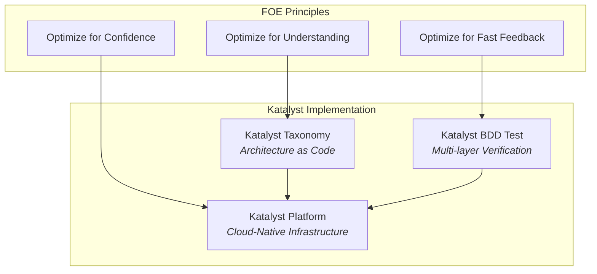

# Katalyst: The FOE Implementation Platform

Katalyst is eSimplicity's concrete implementation of Flow Optimized Engineering principles. While FOE defines *what* to optimize and *why*, Katalyst provides the *how*: a complete platform, tooling ecosystem, and testing framework that makes FOE principles actionable.

## The Katalyst Ecosystem

Katalyst consists of three interconnected components, each mapping directly to FOE's core optimizations:



## Component Overview

### Katalyst Platform

**What it is:** A complete cloud-native infrastructure platform built on Kubernetes, providing deployment automation, observability, secrets management, and networking.

**FOE Alignment:** Optimizes for **Confidence** by providing:
- ArgoCD GitOps with automatic sync and rollback
- Full observability stack (Grafana, Prometheus, Loki, Tempo)
- Service mesh with Istio for mTLS and traffic management
- External Secrets Operator for secure secrets management

**Learn more:** [Katalyst Platform Documentation](https://d3bvp0fxrpttzf.cloudfront.net/)

---

### Katalyst Taxonomy

**What it is:** A framework for modeling your entire software architecture as code, using a four-tier hierarchy: System → Subsystem → Stack → Layer.

**FOE Alignment:** Optimizes for **Understanding** by providing:
- Declarative YAML definitions for all architecture components
- `kata tree` and `kata tui` for visual architecture discovery
- Fully Qualified Taxonomy Names (FQTN) for unambiguous component references
- Schema validation ensuring consistency

**Learn more:** [Katalyst Taxonomy Documentation](https://esimplicityinc.github.io/katalyst-taxonomy/)

---

### Katalyst BDD Test

**What it is:** A comprehensive BDD testing framework built on Playwright, using ports and adapters architecture for clean separation between test logic and implementation.

**FOE Alignment:** Optimizes for **Fast Feedback** by providing:
- Multi-layer testing (API, UI, TUI) in one framework
- Cucumber/Gherkin syntax for readable specifications
- Automatic cleanup and resource management
- Tag-based test filtering (@api, @ui, @tui, @hybrid)

**Learn more:** [Katalyst BDD Test Documentation](https://esimplicityinc.github.io/katalyst-bdd-test/docs/)

---

## FOE → Katalyst Mapping

| FOE Concept | Katalyst Implementation | Component |
|-------------|------------------------|-----------|
| **Optimize for Understanding** | Architecture-as-code with visual navigation | Taxonomy |
| **Optimize for Fast Feedback** | Multi-layer BDD testing with ports & adapters | BDD Test |
| **Optimize for Confidence** | GitOps, auto-rollback, observability | Platform |
| **Institutions** | Layer types enforce patterns via scaffolding | Taxonomy |
| **Paved Paths** | `kata create` generates consistent structure | Taxonomy |
| **Technical Enforcement** | Schema validation, CI gates, policy enforcement | All |
| **Deployment Automation** | ArgoCD reconciliation loop | Platform |
| **Observability** | Grafana/Prometheus/Loki/Tempo stack | Platform |
| **Phase 3+ Capabilities** | Complete cloud-native infrastructure | Platform |
| **Cognitive Triangle** | Discovery → Testing → Safe Deployment | All |

---

## How Katalyst Implements FOE Institutions

FOE describes institutions as "lightweight but real mechanisms that make desired behavior the default." Katalyst provides concrete institutional enforcement:

### 1. Continuous Integration Gate → Katalyst BDD Test

```gherkin
@api
Feature: User Management API

  Scenario: Create and verify user
    Given I am authenticated as an admin via API
    When I POST "/admin/users" with JSON body:
      """
      { "email": "test@example.com", "name": "Test User" }
      """
    Then the response status should be 201
```

Tests run automatically on every PR. Failures block merge.

### 2. Deployment Automation → Katalyst Platform + ArgoCD

```yaml
# ArgoCD Application
apiVersion: argoproj.io/v1alpha1
kind: Application
metadata:
  name: api-gateway
spec:
  source:
    repoURL: https://github.com/org/manifests
    path: apps/api-gateway
  destination:
    server: https://kubernetes.default.svc
  syncPolicy:
    automated:
      selfHeal: true
      prune: true
```

All deployments go through Git. No manual `kubectl apply`. Automatic rollback on failure.

### 3. Definition of Done → Katalyst Taxonomy Layer Types

```bash
kata create layer api-gateway \
  --layer-type app-docker \
  --parent backend-services \
  --owner platform-team@example.com
```

Layer types automatically scaffold:
- Required directory structure
- CI/CD configuration
- Observability integration
- Schema-validated configuration

---

## Getting Started with Katalyst

### Step 1: Understand Your Architecture (Taxonomy)

```bash
# Install Katalyst Taxonomy CLI
pip install katalyst-taxonomy

# Initialize your repository
kata init --yes

# Visualize your architecture
kata tree
```

### Step 2: Define Your Tests (BDD Test)

```bash
# Install the testing framework
npm install @esimplicityinc/stack-tests

# Write feature files
# Run tests
npx playwright test
```

### Step 3: Deploy with Confidence (Platform)

Follow the [Katalyst Platform Developer Guide](https://d3bvp0fxrpttzf.cloudfront.net/docs/developer-guide/intro) to:
- Deploy applications with ArgoCD
- Configure observability
- Manage secrets securely
- Set up networking and ingress

---

## Why Katalyst?

| Challenge | Without Katalyst | With Katalyst |
|-----------|------------------|---------------|
| **Architecture Discovery** | Documentation (gets stale) | `kata tree` / `kata tui` (always current) |
| **Consistent Scaffolding** | Templates (drift over time) | Layer types (enforced by CLI) |
| **Multi-Layer Testing** | Multiple frameworks to maintain | Unified BDD with ports & adapters |
| **Deployment Safety** | Manual verification | ArgoCD auto-sync with rollback |
| **Observability** | Pieced together | Integrated Grafana/Prometheus/Loki/Tempo |
| **Onboarding** | Weeks of exploration | Hours with visual tools |

---

## Next Steps

- Explore [Optimize for Understanding](/docs/principles/optimize-for-understanding) with Katalyst Taxonomy integration
- Explore [Optimize for Fast Feedback](/docs/principles/optimize-for-fast-feedback) with Katalyst BDD Test integration
- Explore [Optimize for Confidence](/docs/principles/optimize-for-confidence) with Katalyst Platform integration
- Read the [Technology Changes](/docs/triad/technology-changes) section for the technical stack details
