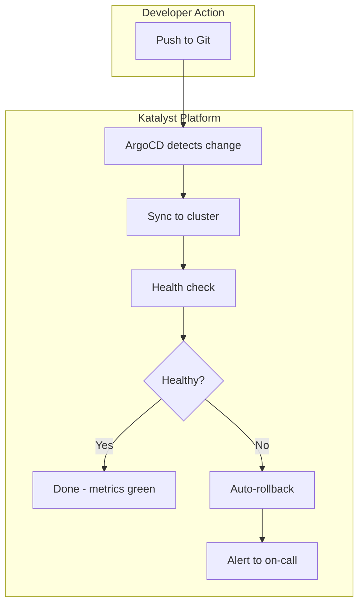

# Optimize for Confidence

Confidence is not certainty. Certainty is knowing the outcome. Confidence is being willing to act when you *don't* know the outcome, because the risk is bounded, visible, and reversible.

> The goal isn't to eliminate uncertainty. It's to make uncertainty safe enough to act within.

## The Difference Between Confidence and Certainty

| Certainty | Confidence |
|-----------|------------|
| "I know this will work" | "I know what happens if it doesn't" |
| Requires perfect information | Operates with incomplete information |
| Paralyzed by unknowns | Acts despite unknowns |
| Seeks to eliminate risk | Seeks to bound risk |
| Rare and often false | Achievable and sustainable |

Certainty is a lie we tell ourselves. Complex systems are inherently unpredictable. Waiting for certainty means waiting forever, or acting when someone forces a deadline, without the preparation that makes action safe.

Confidence is the engineering virtue. It says: "I've done what can be done to make this safe. I've bounded the blast radius. I can recover if I'm wrong. Let's go."

## Why Executives Fear Speed

Engineering leaders often encounter resistance to faster delivery cycles. The surface objection is process or compliance, but the underlying fear is simpler:

**Unbounded downside.**

If something goes wrong:
- How bad will it be?
- Will we know immediately?
- Can we fix it quickly?
- Who gets blamed?

Without good answers to these questions, caution is rational. Slowing down is a risk management strategy for people who don't trust their safety nets.

FOE doesn't argue against caution. It builds the safety nets that make speed genuinely safe.

## What FOE Confidence Means

FOE defines confidence through three statements:

### "I know what will happen if this fails"

Failure modes are understood and bounded. We've thought about what can go wrong and have plans for each scenario. There are no unbounded failure modes lurking in the dark.

**Enables:**
- Honest risk assessment
- Appropriate mitigation
- Stakeholder trust

**Practices:**
- Pre-mortems and failure mode analysis
- Documented rollback procedures
- Blast radius limitation (feature flags, canaries)
- Clear escalation paths

### "I can undo this"

Actions are reversible. If we're wrong, we can get back to a known-good state without heroics. Recovery is a standard operation, not an emergency procedure.

**Enables:**
- Faster decisions (lower stakes per decision)
- More experimentation
- Reduced fear

**Practices:**
- Blue-green deployments
- Feature flags with kill switches
- Database migration rollback strategies
- Infrastructure as code with version history

### "I'm inside the envelope"

We're operating within understood parameters. We're not testing the system in ways it's never been tested. We have evidence, not just hope, that this will work.

**Enables:**
- Accurate mental models
- Predictable behavior
- Trust in the system

**Practices:**
- Production-like test environments
- Load testing before launch
- Incremental rollouts
- Monitoring that detects envelope violations

:::note
These three statements, bounded failure, reversibility, and understood parameters, create rational confidence. Missing any one creates rational fear.
:::

## Guardrails, Not Handcuffs

There's a destructive false dichotomy in software development:

- **Option A**: Heavyweight controls that slow everything down
- **Option B**: Cowboy coding that moves fast and breaks things

FOE rejects both. The goal is guardrails: constraints that prevent catastrophe while enabling speed.

| Handcuffs | Guardrails |
|-----------|------------|
| Require approval for every change | Require approval for *high-risk* changes |
| Prevent any production access | Provide *audited* production access |
| Manual testing for everything | Automated testing with manual review for edge cases |
| Long change windows | Continuous deployment with automatic rollback |
| Process proves diligence | *Evidence* proves diligence |

Guardrails are automated where possible. They're proportional to actual risk. They provide evidence of compliance without requiring human gatekeepers for routine operations.

**Examples:**
- CI/CD pipeline that runs security scans automatically (not a security team reviewing every PR)
- Feature flags that limit exposure (not manual deployment approval)
- Automated rollback on error rate spike (not requiring someone to be watching)
- Audit logs that capture who did what (not requiring dual control for everything)

## The Hidden Dimension: Psychological Safety for Decision-Making

The visible optimization is operational safety. The hidden optimization is **psychological safety for decision-making**: creating environments where people are willing to make decisions and take responsibility.

> This isn't HR psychological safety ("it's okay to speak up in meetings"). This is operational psychological safety ("it's okay to make a judgment call that might be wrong").

Unsafe decision environments produce:
- **Decision avoidance**: Waiting for someone else to decide
- **CYA documentation**: Protecting yourself instead of solving problems
- **Excessive consensus-seeking**: Nobody wants to be the one who decided
- **Politics over engineering**: Decisions made by authority, not evidence
- **Blame culture**: When things go wrong, find the person, not the cause

Safe decision environments produce:
- **Distributed authority**: Decisions made by people with information
- **Fast escalation**: When unsure, asking is easy
- **Blameless postmortems**: Focus on systems, not individuals
- **Ownership**: People volunteer for responsibility
- **Learning from failure**: Mistakes become case studies, not careers ended

:::info
Psychological safety for decision-making is created by design, not exhortation. You can't tell people to "be brave" while punishing mistakes. You have to build systems where mistakes are survivable, and then demonstrate that survival.
:::

## FOE Creates Courage by Design

Courage isn't a character trait to hire for. It's an output of system design.

| System Property | Creates |
|----------------|---------|
| Fast feedback | Courage to experiment (you'll know quickly if you're wrong) |
| Reversibility | Courage to ship (you can undo it) |
| Bounded blast radius | Courage to try new things (failures are limited) |
| Blameless culture | Courage to own problems (admitting failure is safe) |
| Clear escalation | Courage to act (you're not alone) |

When these properties are present, normal people act courageously. When they're absent, even brave people become cautious.

:::tip[GovCon Insight]
Government contracting creates specific confidence challenges:

- **Compliance evidence**: The fear isn't just that something will go wrong; it's that you won't be able to prove you did everything right. FOE's emphasis on traceability, automation, and audit logs produces the evidence that compliance requires.

- **Predictable delivery**: Government customers have budgets, schedules, and political commitments. Unpredictability is threatening even when things go well. Confidence-optimized teams can make and meet commitments because they understand their system's behavior.

- **Safe-to-fail experiments**: Programs need to try new approaches, but failure is career-threatening. FOE creates bounded experiments, limited scope, clear success criteria, documented learnings, that allow innovation without recklessness.

The irony: heavyweight government controls often *reduce* actual safety while increasing the appearance of safety. FOE provides genuine safety with appropriate evidence.
:::

## Practical Implementation

### For Developers

1. **Build reversibility in:** Every change should be undoable
2. **Limit blast radius:** Feature flags, gradual rollouts, circuit breakers
3. **Document failure modes:** What could go wrong? What's the recovery?
4. **Own your changes:** Ship it, watch it, fix it if needed

### For Tech Leads

1. **Make escalation easy:** Questions should be welcomed, not punished
2. **Run blameless postmortems:** Systems fail, not people
3. **Demonstrate recovery:** When things go wrong, show that it's survivable
4. **Protect decision-makers:** Shield the team from blame culture

### For Leaders

1. **Define risk tolerance explicitly:** What's acceptable? What's not?
2. **Celebrate recovery:** A fast fix is a success, not a failure
3. **Reward appropriate risk-taking:** Not just successes, but good decisions with bad outcomes
4. **Build in slack:** Teams under constant pressure can't take any risks

## The Confidence Equation

```
Confidence = f(Understanding, Reversibility, Bounded Failure, Psychological Safety)
```

Increase any factor and confidence rises. Remove any factor and confidence collapses.

| Missing Factor | Result |
|---------------|--------|
| Understanding | Confidence in the dark: recklessness |
| Reversibility | High-stakes decisions: paralysis |
| Bounded failure | Unbounded downside: fear |
| Psychological safety | Personal risk: politics |

## Warning Signs

You're losing confidence when:
- Deployments happen only on Fridays (to have the weekend to fix them)
- Nobody volunteers for new initiatives
- Decisions require excessive sign-off
- "That's above my pay grade" becomes common
- Teams optimize for not being blamed
- Risk discussions focus on CYA, not mitigation

## The Payoff

Teams that optimize for confidence experience:
- Faster decisions (lower stakes per decision)
- More innovation (safe to try new things)
- Better ownership (people volunteer for responsibility)
- Reduced politics (decisions based on evidence, not authority)
- Sustainable pace (not constantly in crisis mode)

Confidence is what allows the other optimizations to function. Understanding is useless if you won't act on it. Fast feedback is useless if you won't risk being wrong. Confidence is the catalyst that turns knowledge into action.

---

## Katalyst Implementation

:::info[With Katalyst]
Katalyst Platform provides the infrastructure that makes confidence rational. Built on Kubernetes with ArgoCD GitOps, comprehensive observability, and automated rollback capabilities, it creates the safety nets that enable speed.
:::

### How Katalyst Platform Enables Confidence

Katalyst Platform implements the three confidence statements:

| FOE Statement | Katalyst Implementation |
|---------------|------------------------|
| **"I know what will happen if this fails"** | Full observability stack (Grafana, Prometheus, Loki, Tempo) |
| **"I can undo this"** | ArgoCD with automatic rollback, GitOps history |
| **"I'm inside the envelope"** | Health checks, canary deployments, traffic management |

### GitOps: Every Change is Reversible

With ArgoCD, all state is in Git. Rollback is `git revert`:

```yaml
# ArgoCD Application with automated sync and self-healing
apiVersion: argoproj.io/v1alpha1
kind: Application
metadata:
  name: api-gateway
spec:
  source:
    repoURL: https://github.com/org/manifests
    path: apps/api-gateway
    targetRevision: HEAD
  destination:
    server: https://kubernetes.default.svc
    namespace: production
  syncPolicy:
    automated:
      selfHeal: true    # Drift detection and correction
      prune: true       # Remove deleted resources
    syncOptions:
      - CreateNamespace=true
```

When something goes wrong:
1. ArgoCD detects unhealthy state
2. Automatic rollback to last known good
3. Alert fires to on-call
4. Team investigates without pressure

### Observability: See What's Happening

The full observability stack provides visibility into every layer:

| Tool | Purpose | Confidence Contribution |
|------|---------|------------------------|
| **Grafana** | Dashboards | "I can see the system's health at a glance" |
| **Prometheus** | Metrics | "I can measure what matters" |
| **Loki** | Logs | "I can understand what happened" |
| **Tempo** | Traces | "I can follow requests through the system" |

```yaml
# Example: Service Level Objective monitoring
groups:
  - name: slo-alerts
    rules:
      - alert: HighErrorRate
        expr: rate(http_requests_total{status=~"5.."}[5m]) > 0.01
        for: 5m
        labels:
          severity: critical
        annotations:
          summary: "Error rate exceeds SLO (>1%)"
```

### Bounded Blast Radius: Istio Traffic Management

Service mesh enables gradual rollouts and instant rollback:

```yaml
# Canary deployment: 10% to new version
apiVersion: networking.istio.io/v1beta1
kind: VirtualService
metadata:
  name: api-gateway
spec:
  hosts:
    - api-gateway
  http:
    - route:
        - destination:
            host: api-gateway
            subset: stable
          weight: 90
        - destination:
            host: api-gateway
            subset: canary
          weight: 10
```

If the canary shows problems, shift traffic back instantly. No full rollout required.

### Secrets Management: Security Without Friction

External Secrets Operator provides secure secrets without slowing down deployment:

```yaml
apiVersion: external-secrets.io/v1beta1
kind: ExternalSecret
metadata:
  name: api-credentials
spec:
  refreshInterval: 1h
  secretStoreRef:
    name: aws-secrets-manager
    kind: ClusterSecretStore
  target:
    name: api-credentials
  data:
    - secretKey: database-password
      remoteRef:
        key: prod/api-gateway/database
        property: password
```

Secrets are:
- Never committed to Git
- Automatically rotated
- Audited and traceable
- Available to applications seamlessly

### The Confidence Stack in Action



The entire flow is:
- **Automated**: No manual deployment steps
- **Observable**: Every step is visible
- **Reversible**: Rollback is instant
- **Auditable**: Full history in Git

### Guardrails via Policy Enforcement

Katalyst Platform integrates policy enforcement to prevent misconfigurations:

```yaml
# OPA/Gatekeeper policy: No containers running as root
apiVersion: constraints.gatekeeper.sh/v1beta1
kind: K8sPSPAllowedUsers
metadata:
  name: require-non-root
spec:
  match:
    kinds:
      - apiGroups: [""]
        kinds: ["Pod"]
  parameters:
    runAsUser:
      rule: MustRunAsNonRoot
```

Policies are:
- Enforced automatically (not by humans)
- Auditable (every decision logged)
- Version-controlled (in Git with the rest)
- Proportional (block dangerous things, allow safe things)

**Learn more:** [Katalyst Platform Documentation](https://d3bvp0fxrpttzf.cloudfront.net/)
