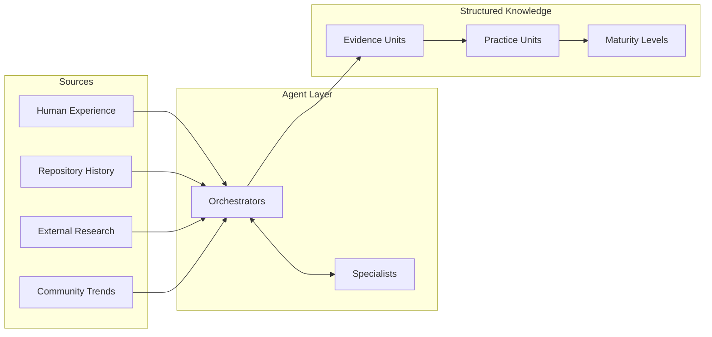
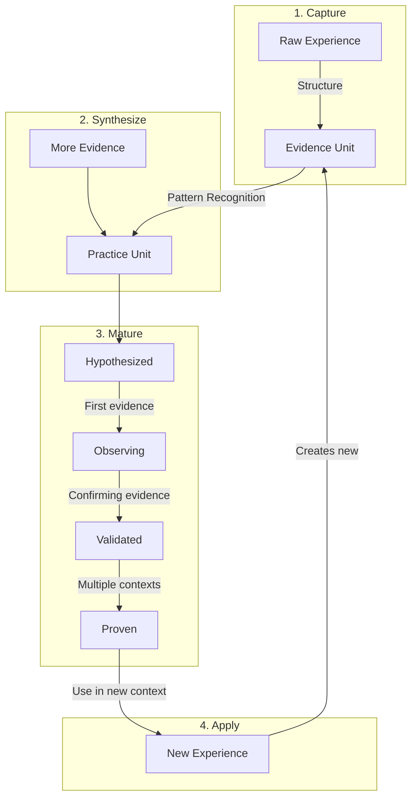
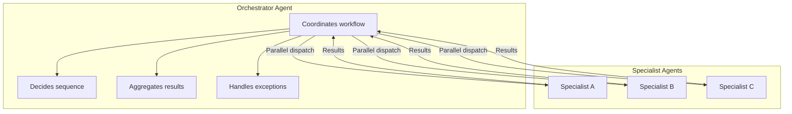
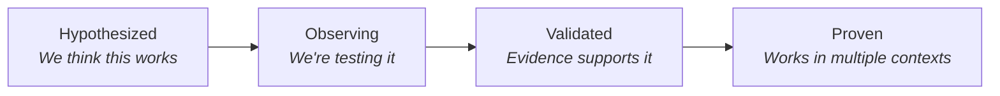

# Agent-Guided Knowledge System

A reusable pattern for building **evidence-backed knowledge systems** where AI agents guide human intent through structured workflows. This pattern enables organizations to capture learning, build practices, and accumulate institutional knowledge with epistemic honesty about confidence levels.

---

## The Pattern at a Glance



**The core insight**: Raw experience becomes institutional knowledge through a lifecycle that agents facilitate but humans control. The system creates transparency about *how much* to trust any given practice through evidence-backed maturity levels.

---

## Core Concepts

The pattern uses four abstract concepts that can be instantiated for any knowledge domain:

| Concept | Definition | Examples |
|---------|------------|----------|
| **Evidence Unit** | A documented observation from experience or research | Post-mortem, experiment result, research finding, insight |
| **Practice Unit** | An actionable approach backed by evidence | Method, playbook, mental model, standard |
| **Knowledge Domain** | A container organizing related practices | Field guide, handbook, personal wiki, research area |
| **Maturity Model** | Transparent confidence levels for practices | Hypothesized → Validated → Proven |

### Why These Abstractions Matter

Traditional knowledge management conflates "someone wrote it down" with "we know this works." This pattern separates:

- **What we've observed** (evidence) from **what we recommend** (practices)
- **How confident we are** (maturity) from **how important it is** (priority)
- **Where it came from** (source type) from **whether it applies here** (context)

---

## The Knowledge Lifecycle

All knowledge in this system flows through a universal lifecycle:



### Phase 1: Capture

Raw experience is transformed into structured evidence. This happens through:

- **Guided questioning** - Agents ask structured questions to extract key details
- **Mandatory critique** - Assumptions are challenged before documentation
- **Source attribution** - Origin and context are preserved

### Phase 2: Synthesize

Patterns emerge across multiple evidence units:

- **Pattern recognition** - What do these observations have in common?
- **Practice extraction** - What actionable guidance can we derive?
- **Bidirectional linking** - Practices link to supporting evidence; evidence links to practices it supports

### Phase 3: Mature

Practices progress through confidence levels as evidence accumulates:

| Level | Meaning | Transition Trigger |
|-------|---------|-------------------|
| **Hypothesized** | Proposed, not yet tested | Initial creation |
| **Observing** | Active testing underway | First evidence unit created |
| **Validated** | Supporting evidence exists | Completed observations with results |
| **Proven** | Multiple contexts confirm | Evidence from different contexts |

### Phase 4: Apply

Proven practices guide new work, which generates new experiences, completing the cycle.

---

## Agent Architecture

The pattern uses a specific agent topology that maps to how expertise actually works.

### Orchestrator + Specialist Pattern



**Why this topology**:
- **Orchestrators** are generalists that understand the full workflow
- **Specialists** go deep on narrow tasks without workflow awareness
- **Parallel execution** where tasks are independent (performance)
- **Sequential handoffs** where dependencies exist (correctness)

### The Five Agent Roles

Each role addresses a different knowledge management need:

| Role | Function | When Triggered | Subagent Pattern |
|------|----------|----------------|------------------|
| **Alchemist** | Transform experience → evidence | "I learned something" | intake → critique → scribe → mapper |
| **Synthesist** | Transform evidence → practice | "I see a pattern" | analyzer → scribe |
| **Prospector** | Mine sources for opportunities | "What have we missed?" | parallel source miners |
| **Cartographer** | Import external knowledge | "Adopt this framework" | researcher → validator → scribe |
| **Scout** | Survey emerging trends | "What's new out there?" | parallel platform crawlers |

### Agent Role Details

#### Alchemist (Experience → Evidence)

The Alchemist guides users through documenting observations:

```
Phase 1: Intake
    ├── Gather source materials (docs, URLs, context)
    └── Understand what happened
    
Phase 2: Structured Questioning
    ├── What did this reveal about how things work? (Understanding)
    ├── What feedback loops were affected? (Fast Feedback)
    └── What risks were reduced or revealed? (Confidence)
    
Phase 3: Critique (MANDATORY)
    ├── Challenge assumptions
    ├── Identify confounding variables
    └── Question causation claims
    
Phase 4: Write
    └── Create structured evidence unit
    
Phase 5: Map
    └── Link to existing practices or suggest new ones
```

#### Synthesist (Evidence → Practice)

The Synthesist finds patterns across evidence and extracts practices:

```
Step 1: Gather related evidence units
Step 2: Analyze for common patterns
Step 3: Name the emerging practice
Step 4: Define applicability (when to use, when not to)
Step 5: Extract actionable steps
Step 6: Determine initial maturity level
Step 7: Write practice unit with bidirectional links
```

#### Prospector (Discovery)

The Prospector mines existing sources for undocumented learning:

```
Parallel analysis of:
├── Commit history (debugging crunches, reverts, refactoring waves)
├── Issues (bug clusters, retrospectives, tech debt)
├── Pull requests (architectural debates, learning moments)
├── CI configuration (pipeline evolution, test additions)
├── Test patterns (coverage gaps, late additions)
├── Documentation (gaps, staleness, knowledge concentration)
└── Dependencies (major bumps, forks, security updates)

Output: Ranked opportunities for evidence capture
```

#### Cartographer (External Import)

The Cartographer brings external knowledge into the system:

```
Phase 1: Research external source
Phase 2: Validate legitimacy and status
Phase 3: Select which elements to import
Phase 4: Write structured documentation
Phase 5: Suggest adoptions into knowledge domains
```

#### Scout (Trend Surveillance)

The Scout surveys external sources for emerging trends:

```
Parallel crawl of:
├── Community platforms (Reddit, forums)
├── Video content (YouTube, conferences)
├── Code repositories (GitHub trending, releases)
├── Academic sources (arXiv, papers)
└── Practitioner content (blogs, Twitter)

Output: Delta report (new vs. evolved vs. recurring)
```

---

## Quality Architecture

Three mechanisms ensure knowledge quality:

### 1. Mandatory Critique

The critique phase **cannot be skipped**. Before any evidence unit is finalized:

- Assumptions are surfaced and challenged
- Alternative explanations are considered
- Limitations are documented
- Causation vs. correlation is distinguished

**Why it matters**: Without critique, knowledge systems become echo chambers. The Alchemist-critic role exists specifically to prevent confirmation bias.

### 2. The Maturity Model

Maturity levels create **epistemic honesty**:



Users always know:
- How much confidence to place in a practice
- What evidence backs it
- Where the gaps are

**Maturity can decrease**: If new evidence contradicts a practice, it can move backward. This is a feature, not a bug.

### 3. Bidirectional Traceability

Every link goes both ways:

```
Practice Unit
    └── observations: [evidence-1, evidence-2, evidence-3]

Evidence Unit
    └── methods: [practice-a, practice-b]
```

This enables:
- **Impact analysis**: "If I doubt this evidence, what practices are affected?"
- **Gap detection**: "This practice has no supporting evidence"
- **Audit trails**: "Why do we believe this?"

---

## Applying the Pattern

To instantiate this pattern for a new domain, define:

### Domain Configuration

```yaml
domain:
  name: "Your Domain Name"
  slug: "domain-slug"
  
evidence_unit:
  singular: "observation"      # What is one piece of evidence called?
  plural: "observations"
  types:                       # What kinds of evidence exist?
    - name: "internal"
      label: "First-hand"
    - name: "external"
      label: "Research"
      
practice_unit:
  singular: "method"           # What is one practice called?
  plural: "methods"
  
maturity_model:
  levels:
    - name: "hypothesized"
      description: "Proposed, not yet tested"
    - name: "observing"
      description: "Active testing"
    - name: "validated"
      description: "Supporting evidence"
    - name: "proven"
      description: "Multiple confirmations"
  transitions:
    - from: "hypothesized"
      to: "observing"
      trigger: "First evidence created"
    - from: "observing"
      to: "validated"
      trigger: "Completed evidence with results"
    - from: "validated"
      to: "proven"
      trigger: "Evidence from different contexts"

critique_criteria:            # Domain-specific critique questions
  - "Is the claim falsifiable?"
  - "What alternative explanations exist?"
  - "What context might limit applicability?"
```

### Example Domain Instantiations

| Domain | Evidence Unit | Practice Unit | Example Lifecycle |
|--------|--------------|---------------|-------------------|
| **Engineering Practices** | Observation | Method | Production incident → Post-mortem → Prevention playbook |
| **Product Experiments** | Experiment | Playbook | Hypothesis → A/B test → Growth playbook |
| **Personal Learning** | Insight | Mental Model | Book highlights → Key insight → Thinking framework |
| **Research Synthesis** | Finding | Thesis | Paper → Extracted claim → Synthesized position |
| **Security Practices** | Incident | Control | Breach attempt → Analysis → Security standard |

---

## FOE Field Guides as an Instance

Flow Optimized Engineering's Field Guide system is a concrete instantiation of this pattern:

| Abstract Concept | FOE Instantiation |
|-----------------|-------------------|
| Evidence Unit | Observation (internal or external) |
| Practice Unit | Method |
| Knowledge Domain | Field Guide |
| Maturity Model | Hypothesized → Observing → Validated → Proven |

The FOE agents (Alchemist, Synthesist, Prospector, Cartographer, Scout) implement the five agent roles described above, specialized for software engineering practices.

### What FOE Adds

Beyond the base pattern, FOE's instantiation includes:

- **FOE Principles Integration**: Every observation is questioned through the lens of Understanding, Fast Feedback, and Confidence
- **External Framework Adoption**: Practices can be adopted from external frameworks (DORA, BDD, etc.) with independent FOE maturity tracking
- **Source Quality Tiers**: External evidence is rated (Academic > Industry Research > Case Study > Practitioner)

---

## Why This Pattern Works

### For Individuals

- **Structured capture** prevents valuable learning from being lost
- **Maturity levels** help prioritize what to apply
- **Critique** strengthens thinking

### For Teams

- **Shared vocabulary** for discussing confidence
- **Transparent evidence** enables constructive disagreement
- **Accumulated knowledge** outlasts individual tenure

### For Organizations

- **Institutional memory** that's searchable and linked
- **Evidence-based standards** instead of opinion-based mandates
- **Continuous improvement** with measurable maturity

---

## See Also

- [Field Guides Overview](/docs/field-guides/overview) - FOE's implementation of this pattern
- [Using AI Agents](/docs/field-guides/using-ai-agents) - How to interact with the agents
- [Pattern Library](/docs/reference/pattern-library) - Reusable implementation patterns (content within the system)
