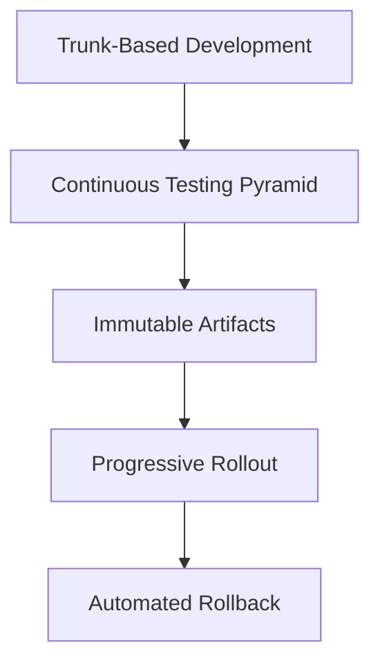
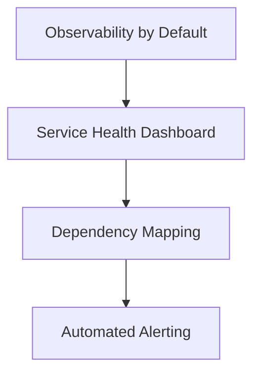
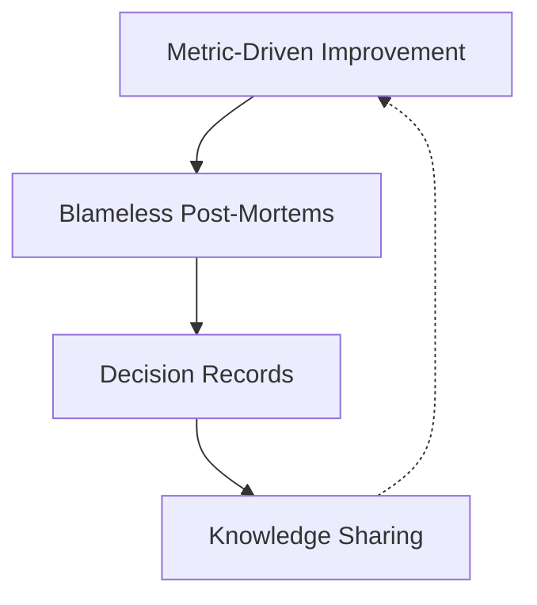

# Pattern Library

Reusable patterns for implementing Flow Optimized Engineering. Each pattern addresses a specific problem and can be combined with others to build comprehensive FOE capability.

Patterns are organized by primary function:
- **Understanding Patterns**: Know what's happening
- **Feedback Patterns**: Learn from what happened
- **Confidence Patterns**: Trust what will happen

---

## Understanding Patterns

These patterns help you know the current state of your systems and processes.

### Single Source of Truth

**Problem**: Multiple systems claim authority over the same information. Desired state is scattered across tickets, wikis, scripts, and tribal knowledge. No one knows what's actually supposed to be running.

**Solution**: Establish one authoritative source for each category of truth. For desired state: Git repositories with declarative configurations. For actual state: Production systems themselves. For decisions: Recorded artifacts (ADRs, RFCs).

**When to Use**: Always. This is foundational.

**Implementation**:
1. Identify categories of truth in your organization
2. For each category, designate one authoritative source
3. Make all other sources derived or deprecated
4. Enforce through automation: reconciliation loops compare actual to desired

**Example**:
```yaml
# Desired state lives in Git
# kubernetes/production/deployment.yaml
apiVersion: apps/v1
kind: Deployment
metadata:
  name: api-service
spec:
  replicas: 3
  # GitOps controller ensures production matches this file
```

**Related Patterns**: Declarative Configuration, GitOps Reconciliation

---

### Observability by Default

**Problem**: Systems are black boxes. When problems occur, debugging requires adding instrumentation after the fact. Production issues take longer to diagnose than to fix.

**Solution**: Make observability a first-class requirement. All services emit metrics, logs, and traces from day one. Instrumentation is part of the definition of "done."

**When to Use**: Every new service. Retrofit existing services during any significant modification.

**Implementation**:
1. Standardize on observability frameworks (OpenTelemetry)
2. Include observability in service templates
3. Require observability review in PR checklist
4. Create dashboards as part of service deployment

**Example**:
```python
# Service template includes tracing from the start
from opentelemetry import trace

tracer = trace.get_tracer(__name__)

@app.route('/api/users/<id>')
def get_user(id):
    with tracer.start_as_current_span("get_user") as span:
        span.set_attribute("user.id", id)
        # Business logic here
```

**Related Patterns**: Service Health Dashboard, Distributed Tracing

---

### Dependency Mapping

**Problem**: No one knows what depends on what. Changes to shared services cause unexpected failures. Impact analysis is guesswork.

**Solution**: Automatically discover and document service dependencies through runtime observation and static analysis. Make the dependency graph visible and queryable.

**When to Use**: Once you have more than a few services. Essential before microservices adoption.

**Implementation**:
1. Use service mesh or tracing to observe runtime dependencies
2. Use static analysis for build-time dependencies
3. Visualize the dependency graph
4. Alert on new or unexpected dependencies

**Example**:
```
Service: payment-processor
Dependencies:
  - user-service (auth validation)
  - notification-service (receipt emails)
  - database/payments (PostgreSQL)
  
Dependents:
  - checkout-api
  - subscription-manager
  - admin-dashboard
```

**Related Patterns**: Service Catalog, Impact Analysis

---

### Decision Records

**Problem**: Decisions are made and forgotten. Six months later, no one remembers why something was done a certain way. New team members make the same mistakes.

**Solution**: Record significant decisions in a structured format. Capture context, options considered, decision made, and consequences expected.

**When to Use**: Architectural decisions, technology choices, process changes, and any decision you might need to explain or revisit later.

**Implementation**:
1. Create ADR (Architecture Decision Record) template
2. Store ADRs in the relevant repository
3. Link ADRs to related code and tickets
4. Review ADRs during onboarding

**Example**:
```markdown
# ADR-0042: Use PostgreSQL for Payment Data

## Status
Accepted

## Context
We need to store payment transaction data with ACID guarantees.

## Decision
Use PostgreSQL with row-level security for payment data storage.

## Consequences
- Strong consistency guarantees
- Operational overhead of managing PostgreSQL
- Team needs PostgreSQL expertise
```

**Related Patterns**: Single Source of Truth, Onboarding Paths

---

## Feedback Patterns

These patterns help you learn from outcomes and improve over time.

### Continuous Testing Pyramid

**Problem**: Tests exist but don't catch bugs. Test suite is slow and brittle. Developers skip tests or ignore failures.

**Solution**: Structure tests in a pyramid: many fast unit tests, fewer integration tests, few end-to-end tests. Each layer catches appropriate defects. The pyramid runs quickly and reliably.

**When to Use**: Every project with automated tests. Reshape existing test suites toward the pyramid.

**Implementation**:
1. Audit existing tests by layer
2. Set targets for each layer (e.g., 70% unit, 20% integration, 10% e2e)
3. Make unit tests fast enough to run on save
4. Run full pyramid on every commit

**Example**:


*Many fast unit tests at the base, fewer integration tests in the middle, minimal E2E tests at the top.*

**Related Patterns**: Test in Production, Mutation Testing

---

### Deployment Frequency Optimization

**Problem**: Deployments are big, scary, and rare. Each deployment is a major event. Bugs accumulate between deployments.

**Solution**: Deploy smaller changes more frequently. Reduce batch size until deployment is routine. Target: deploying should feel like saving a file.

**When to Use**: When deployments are stressful or when time between commit and production exceeds a day.

**Implementation**:
1. Measure current deployment frequency
2. Identify deployment friction points
3. Automate or eliminate each friction point
4. Reduce batch size as deployments become easier

**Example**:
```
Evolution of deployment frequency:
Month 1: Monthly deploys (12/year)
Month 3: Weekly deploys (52/year)
Month 6: Daily deploys (250/year)
Month 12: On-demand deploys (500+/year)
```

**Related Patterns**: Trunk-Based Development, Feature Flags

---

### Blameless Post-Mortems

**Problem**: Incidents lead to blame. Blame leads to hiding problems. Hidden problems lead to worse incidents. Learning is replaced by punishment.

**Solution**: Conduct post-mortems that focus on system improvement, not individual fault. Ask "how did the system allow this?" not "who did this?"

**When to Use**: After every significant incident. Also after near-misses and notable successes.

**Implementation**:
1. Establish post-mortem template focused on timeline, impact, and improvements
2. Train facilitators in blameless technique
3. Publish post-mortems widely
4. Track action items to completion

**Example**:
```markdown
## Post-Mortem: Payment Processing Outage

### What Happened
Database connection pool exhausted due to connection leak.

### Not: Who's Fault
"Developer X wrote buggy code": Not useful

### Instead: System Questions
- Why didn't connection monitoring alert us?
- Why didn't code review catch the leak?
- Why doesn't our test environment catch connection issues?

### Improvements
1. Add connection pool monitoring
2. Add connection leak detection to pipeline
3. Update code review checklist
```

**Related Patterns**: Learning Culture, Incident Response

---

### Metric-Driven Improvement

**Problem**: Improvements are proposed based on intuition. We don't know if changes helped. "Better" is a feeling, not a measurement.

**Solution**: Establish baseline metrics before changes. Define success criteria. Measure after. Keep changes that improve metrics; revert changes that don't.

**When to Use**: Any significant process or technology change.

**Implementation**:
1. Define metrics that matter for this change
2. Measure baseline (at least 2 weeks of data)
3. Implement change
4. Measure outcome
5. Decide: keep, modify, or revert

**Example**:
```
Initiative: Reduce code review latency

Baseline (2 weeks): 
  - Median review time: 18 hours
  - P90 review time: 72 hours

Change: Implement review rotation schedule

After (4 weeks):
  - Median review time: 4 hours
  - P90 review time: 24 hours

Decision: Keep change, continue monitoring
```

**Related Patterns**: DORA Metrics, Experiment Tracking

---

## Confidence Patterns

These patterns help you trust that changes will be safe and successful.

### Progressive Rollout

**Problem**: Deploying to 100% of users immediately means 100% of users are affected by problems. Rollbacks are reactive, not proactive.

**Solution**: Roll out changes to a small percentage of traffic first. Monitor for problems. Gradually increase percentage if metrics stay healthy. Automatic rollback if metrics degrade.

**When to Use**: Production deployments of any change with user impact.

**Implementation**:
1. Configure traffic splitting (service mesh, load balancer, feature flags)
2. Define health metrics and thresholds
3. Automate rollout progression
4. Automate rollback on threshold breach

**Example**:
```yaml
# Progressive rollout configuration
rollout:
  stages:
    - percentage: 5
      duration: 10m
      metrics:
        - error_rate < 0.1%
        - latency_p99 < 500ms
    - percentage: 25
      duration: 30m
    - percentage: 50
      duration: 1h
    - percentage: 100
```

**Related Patterns**: Canary Deployment, Feature Flags, Blue-Green

---

### Policy as Code

**Problem**: Policies exist in documents. Enforcement is manual and inconsistent. Compliance is verified by audit, not automation.

**Solution**: Express policies as executable code. Enforce policies in CI/CD pipelines. Violations are impossible to merge, not just discouraged.

**When to Use**: Any policy that can be verified automatically: security requirements, compliance rules, coding standards.

**Implementation**:
1. Identify policies suitable for automation
2. Express policies in appropriate language (OPA/Rego, custom linters)
3. Integrate policy checks into CI/CD
4. Block violations, don't just warn

**Example**:
```rego
# OPA policy: no containers running as root
package kubernetes.admission

deny[msg] {
    input.request.kind.kind == "Pod"
    container := input.request.object.spec.containers[_]
    container.securityContext.runAsUser == 0
    msg := sprintf("Container %v runs as root", [container.name])
}
```

**Related Patterns**: Guardrails, Automated Governance

---

### Immutable Artifacts

**Problem**: "It worked in staging" because staging had a different version than expected. Build artifacts are modified between environments. Deployments aren't reproducible.

**Solution**: Build once, deploy everywhere. Artifacts are versioned, signed, and immutable. The same artifact goes to dev, staging, and production.

**When to Use**: Always. Non-negotiable for production systems.

**Implementation**:
1. Build artifacts in CI (not locally)
2. Tag artifacts with commit SHA
3. Sign artifacts for integrity verification
4. Promote artifacts between environments, don't rebuild

**Example**:
```
Build:
  commit: abc123
  artifact: registry.example.com/api:abc123
  signature: sha256:def456...

Promotions:
  dev     → staging → production
  (same artifact, different configs)
```

**Related Patterns**: Reproducible Builds, Artifact Registry

---

### Automated Rollback

**Problem**: Rollbacks are manual and slow. During incidents, the decision to roll back is delayed because it's disruptive and uncertain.

**Solution**: Make rollback automatic based on health metrics. The system rolls back without human intervention if thresholds are breached. Humans can override, but the default is safety.

**When to Use**: Production deployments. Also valuable for configuration changes.

**Implementation**:
1. Define rollback triggers (error rate, latency, crash rate)
2. Configure automatic rollback in deployment system
3. Ensure previous version is always available
4. Alert on automatic rollback (for learning, not for intervention)

**Example**:
```yaml
# ArgoCD rollback configuration
rollout:
  analysis:
    failureLimit: 2
  metrics:
    - name: error-rate
      provider: prometheus
      query: |
        sum(rate(http_errors[5m])) / sum(rate(http_requests[5m]))
      successCondition: result < 0.01
  rollbackWindow:
    revisions: 3
```

**Related Patterns**: Progressive Rollout, Health Monitoring

---

### Trunk-Based Development

**Problem**: Long-lived branches diverge from trunk. Merges are painful and error-prone. Integration happens late when problems are expensive to fix.

**Solution**: Work on short-lived branches (hours to days, not weeks). Merge to trunk frequently. Keep trunk always deployable. Use feature flags for incomplete work.

**When to Use**: All new projects. Migrate existing projects as part of flow improvement.

**Implementation**:
1. Set branch lifetime limits (e.g., max 2 days)
2. Require small, focused PRs
3. Implement feature flags for work-in-progress
4. Monitor and alert on long-lived branches

**Example**:


*Good: frequent small merges. Bad: long-lived branches with painful integration.*

**Related Patterns**: Feature Flags, Continuous Integration

---

## Pattern Combinations

Patterns work together. Common combinations:

### The Deployment Confidence Stack



### The Observability Foundation



### The Learning Loop



---

## See Also

- [Anti-Patterns](/docs/reference/anti-patterns): What to avoid
- [Technology Reference](/docs/reference/technology-reference): Tools that support these patterns
- [Transformation Model](/docs/transformation-model/overview): When to adopt each pattern
