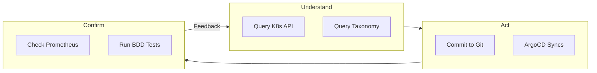

# Phase 4: Agentic Coding

Phase 4 marks the emergence of AI coding agents as a primary mode of software development. This fundamentally changes the economics of code production, making code abundant while creating new scarcities in alignment and verification. Organizations that haven't established Phase 3 disciplines face accelerated chaos.

## The New Economics

AI coding agents change what's expensive and what's cheap:

| Before Agents | After Agents |
|---------------|--------------|
| Code production is expensive | Code production is cheap |
| Backlogs represent resource constraints | Backlogs shrink artificially |
| Developer time is the bottleneck | Verification capacity is the bottleneck |
| Quality through careful development | Quality through rigorous verification |
| Slow pace limits damage | Fast pace amplifies damage |

The implications are profound. When code is cheap to produce, organizations can generate more of it than they can responsibly verify, deploy, and maintain.

## Code Abundance

AI agents can produce code at unprecedented rates:

```
Traditional Development:
┌─────────┐    ┌─────────┐    ┌─────────┐    ┌─────────┐
│ Backlog │───▶│ Design  │───▶│ Develop │───▶│ Deploy  │
│ (Large) │    │ (Slow)  │    │ (Slow)  │    │ (Gated) │
└─────────┘    └─────────┘    └─────────┘    └─────────┘

Agentic Development:
┌─────────┐    ┌─────────┐    ┌─────────────────────┐    ┌─────────┐
│ Backlog │───▶│ Prompt  │───▶│ Generate (Fast x10) │───▶│ Verify? │
│ (Small?)│    │ (Fast)  │    │                     │    │ (???)   │
└─────────┘    └─────────┘    └─────────────────────┘    └─────────┘
```

This creates several dynamics:

**Backlog illusion**: Backlogs shrink not because problems are solved, but because code is generated faster. The underlying verification and integration work hasn't accelerated.

**Quantity over quality pressure**: It's now possible to generate far more code than can be properly reviewed. Organizations face pressure to "ship faster" without proportional investment in verification.

**Technical debt acceleration**: Code produced faster than it can be understood accumulates as technical debt faster than ever.

## What Becomes Scarce

When code production is abundant, other things become the constraint:

### Alignment

Does the generated code actually solve the intended problem?

- AI agents produce plausible code that may not address root causes
- Subtle misunderstandings compound across generated components
- Intent must be communicated precisely, which remains hard
- Verification that code matches intent becomes critical

### Verification

Can we confirm the code is correct, secure, and maintainable?

- Review capacity doesn't scale with generation capacity
- Automated testing catches some issues but not all
- Security review becomes bottleneck
- Architecture coherence requires human judgment

### Integration

Does the code work within the larger system?

- Generated components may not follow system patterns
- Dependencies may conflict or duplicate
- Performance characteristics may not match system requirements
- Operational concerns may be overlooked

### Maintenance

Can we understand and modify this code later?

- Code generation often lacks context that humans would preserve
- Documentation may be generated but not accurate
- Future modifications require understanding original intent
- AI-generated code may be harder to debug than human-written code

## Drift and Entropy

Phase 4 introduces new entropy dynamics:

### Configuration Drift

AI agents make changes across systems. Without discipline:
- Changes accumulate that no one fully understands
- System state diverges from documented state
- Interactions between changes create emergent behavior
- "It was working before the agent touched it" becomes common

### Architecture Drift

Generated code may not follow intended architecture:
- Patterns proliferate as agents generate variations
- Dependencies form that weren't designed
- Services take on responsibilities they shouldn't have
- System boundaries erode

### Knowledge Drift

Understanding of systems degrades:
- Code was generated, not designed, so no one fully understands it
- Documentation describes what was intended, not what exists
- Tribal knowledge can't form around code nobody wrote
- Onboarding becomes harder despite more documentation

:::warning[Common Pitfall]
Treating AI-generated code as equivalent to human-written code. Generated code requires different verification approaches. It may be syntactically correct but semantically wrong. It may follow patterns that were deprecated. It may introduce dependencies that weren't intended. Review processes must adapt.
:::

## Why Phase 3 Is Prerequisite

Phase 4 without Phase 3 is dangerous:

| Phase 3 Discipline | Why It's Required for Phase 4 |
|--------------------|-------------------------------|
| **Standardized patterns** | Agents need clear patterns to follow |
| **Automated enforcement** | Human review can't scale to agent output |
| **Reconciliation-based ops** | Drift must be detected and corrected automatically |
| **Policy as code** | Governance must be automated, not manual |
| **GitOps** | All changes must be tracked and reversible |

Without Phase 3:
- Agents generate non-standard code that creates maintenance burden
- Manual review becomes bottleneck, negating productivity gains
- Drift accumulates unchecked until systems fail
- Governance depends on humans who can't keep pace
- Changes can't be tracked or rolled back reliably

**Phase 3 disciplines don't just enable Phase 4; they make it survivable.**

---

## Katalyst: The Phase 3 Foundation for Agentic Coding

The [Katalyst ecosystem](../katalyst/overview) provides the concrete implementation of Phase 3 disciplines that make Phase 4 survivable. These aren't "nice to have" optimizations—they're the infrastructure that determines whether agents amplify your productivity or your chaos.

| Phase 3 Discipline | Katalyst Implementation | Why Agents Need It |
|--------------------|------------------------|-------------------|
| **Declarative state** | Kubernetes API | Agents need queryable, consistent truth |
| **Standardized patterns** | Taxonomy layer types | Agents follow defined patterns, not guesses |
| **Automated enforcement** | Schema validation, CI gates | Human review can't scale to agent output |
| **Reconciliation-based ops** | ArgoCD GitOps | Drift corrected automatically at machine speed |
| **Policy as code** | OPA/Gatekeeper integration | Governance happens before damage, not after |
| **Observability** | Prometheus/Grafana/Loki | Agents verify their own work programmatically |

### The Agent Cognitive Loop

Agents need the same cognitive triangle humans do—**Understand, Act, Confirm**—but they can't fake it with intuition:



Without Katalyst infrastructure, agents:
- **Can't understand**: No reliable way to query system state
- **Can't act safely**: Changes bypass review, can't be rolled back
- **Can't confirm**: No programmatic feedback on whether changes worked

**See [Katalyst for Agentic Coding](../katalyst/agentic-coding) for detailed implementation guidance.**

---

## Symptom Checklist: Phase 4 Challenges

You're experiencing Phase 4 entropy if:

- [ ] Code is being generated faster than it can be reviewed
- [ ] "The AI wrote that" is explanation for why something is unclear
- [ ] Configuration drift is increasing despite automation
- [ ] New patterns appear that don't match architecture standards
- [ ] Dependencies are added that no one explicitly approved
- [ ] Bug reports reference code that no team member recalls writing
- [ ] Test coverage is increasing but confidence is decreasing
- [ ] Documentation exists but doesn't match implementation

## What Works at This Phase

**With Phase 3 foundation:**
- Automated policy enforcement catches common issues
- Standardized patterns guide agent output
- GitOps ensures all changes are tracked and reversible
- Reconciliation corrects drift automatically
- Review focuses on intent alignment, not syntax

**Emerging practices:**
- Agent output treated as "draft" requiring verification
- Multiple verification layers (automated + human)
- Architecture fitness functions as automated gates
- Explicit agent scope limits
- Frequent reconciliation between generated and intended state

## What Fails at This Phase

**Trusting agent output without verification**: Generated code can be wrong in subtle ways
**Scaling generation without scaling verification**: Creates technical debt faster than ever
**Manual governance**: Can't keep pace with agent output volume
**Assuming agents follow patterns**: They generate plausible code, not necessarily compliant code
**Treating speed as success metric**: Velocity without quality creates liability

## Exit Criteria (For Phase 5)

Progressing to Phase 5 requires:

1. **Verification discipline**: Robust processes for validating agent output
2. **Pattern governance**: Agents reliably produce standard-compliant code
3. **Drift management**: Entropy is detected and corrected continuously
4. **Alignment practice**: Intent is communicated and verified effectively
5. **Quality metrics**: Measuring outcomes, not just output volume

## Disciplines Required

| Discipline | Requirement |
|------------|-------------|
| **Automated Verification** | Multiple automated gates for generated code |
| **Pattern Enforcement** | Agents constrained to produce standard patterns |
| **Continuous Reconciliation** | Drift detected and corrected automatically |
| **Intent Documentation** | Clear capture of what code should accomplish |
| **Output Auditing** | Tracking what agents produced and why |

:::tip[GovCon Insight]
Phase 4 represents the emerging frontier of government AI adoption. Positioning here requires nuance:

**Current landscape:**
- AI coding tools are being adopted rapidly across government
- Responsible AI requirements are emerging but immature
- Most agencies lack frameworks for AI-generated code governance
- Security concerns about AI-generated code are significant

**Proposal opportunities:**
- AI governance frameworks that address Phase 4 challenges
- Verification pipelines specifically designed for AI-generated code
- Training programs for working effectively with AI coding agents
- Risk frameworks that address drift and entropy dynamics

**Differentiation strategies:**
- Acknowledge that AI productivity claims require verification discipline
- Propose metrics beyond velocity: alignment accuracy, drift rates, maintenance burden
- Include Phase 3 foundation as prerequisite for responsible AI adoption
- Address security review at scale for AI-generated code

**Warning signs:**
- RFPs that assume AI adoption is purely additive (more code = better)
- Requirements that don't address verification scaling
- Timelines that assume AI accelerates delivery without new verification burden
- No mention of governance for AI-generated artifacts
:::

## The Path Forward

Succeeding at Phase 4 requires:

1. **Phase 3 foundation**: Ensure disciplines are in place before scaling agent use
2. **Verification investment**: Scale review capacity alongside generation capacity
3. **Pattern constraints**: Configure agents to follow established patterns
4. **Drift detection**: Monitor for entropy and correct continuously
5. **Alignment focus**: Invest in intent communication and verification
6. **Realistic expectations**: Agents accelerate some things; they create new work in others

Phase 4 is not optional; AI coding agents are already here. The question is whether organizations adopt them with discipline or let them amplify existing chaos.
